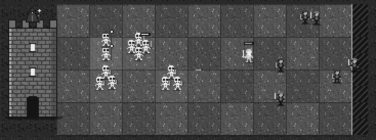
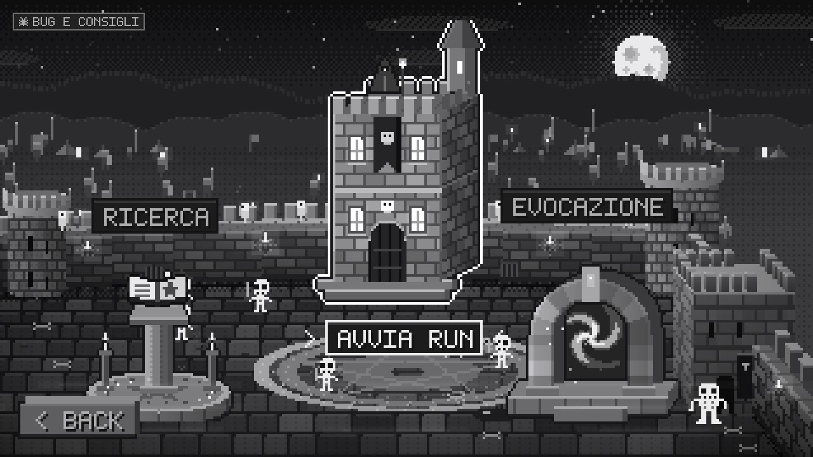
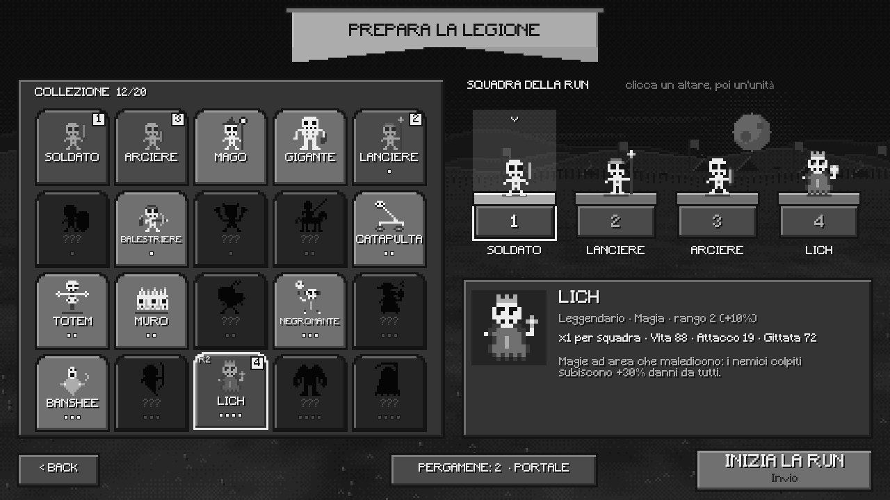
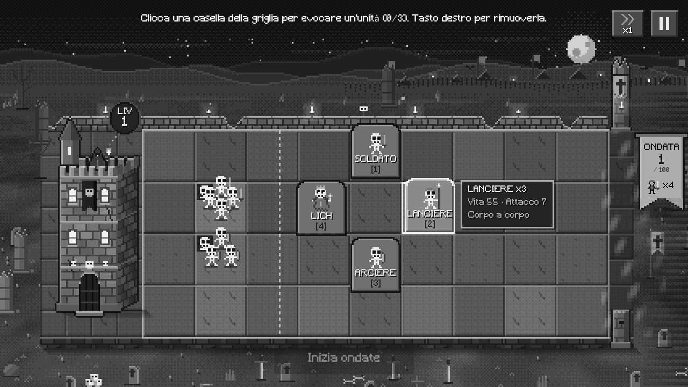
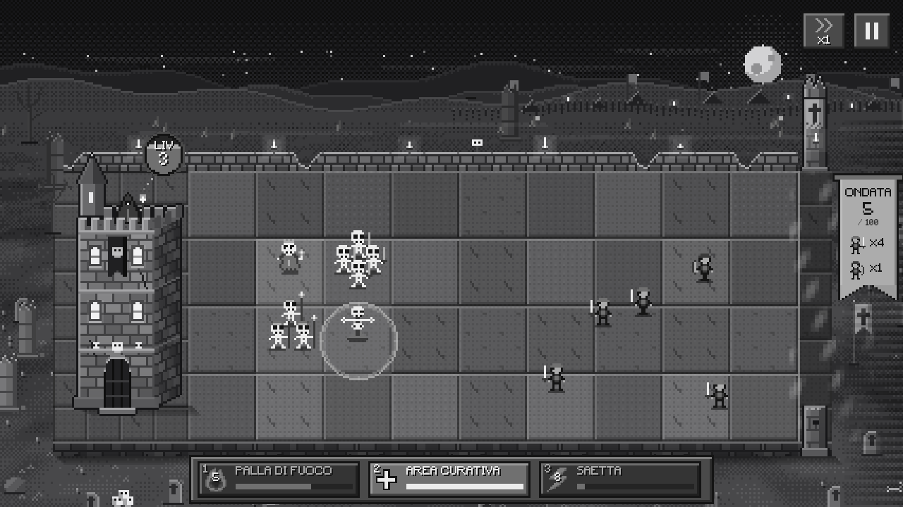
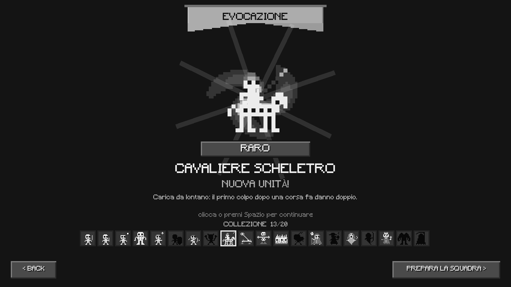
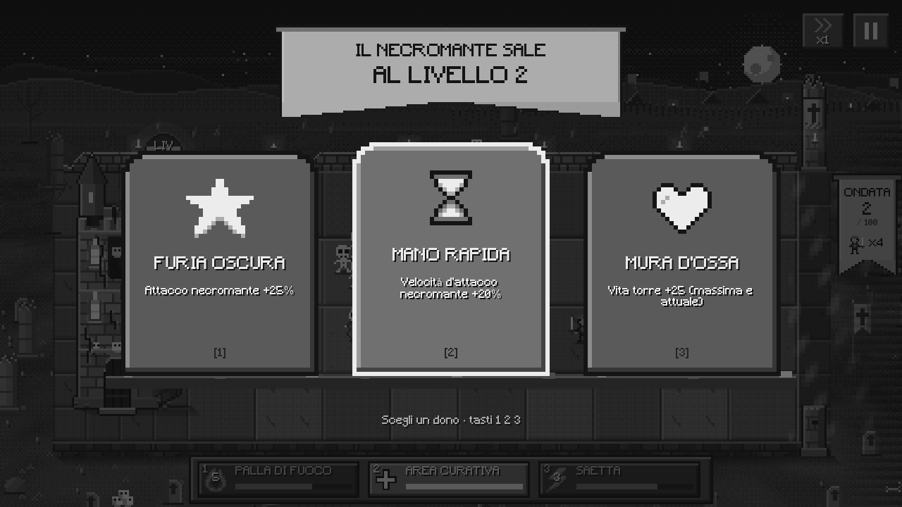
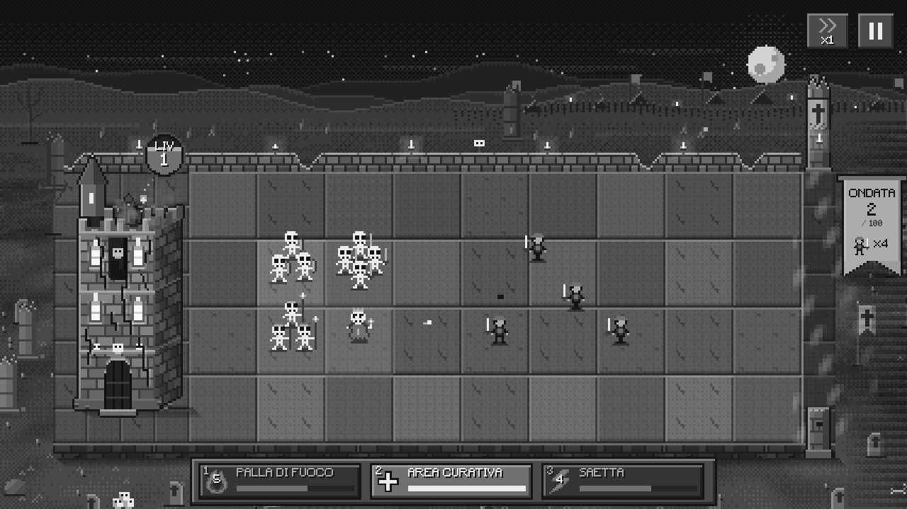
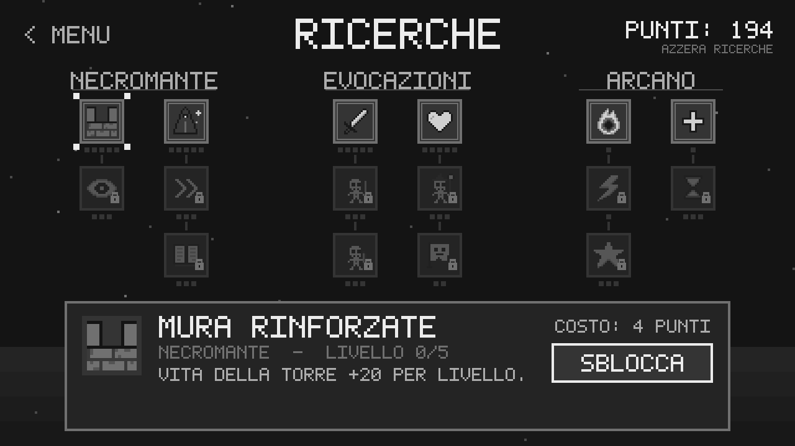

<div align="center">

# 💀 Gioco Scheletri

**Tower defense roguelike in pixel art: sei un necromante chiuso nella sua torre e devi resistere a 100 ondate di eroi.**




</div>

---

## Indice

- [Il gioco](#il-gioco)
- [Caratteristiche](#caratteristiche)
- [Screenshot](#screenshot)
- [Come si gioca](#come-si-gioca)
  - [Il ciclo di una run](#il-ciclo-di-una-run)
  - [Il castello: il menu principale](#il-castello-il-menu-principale)
  - [Preparazione: la squadra della run](#preparazione-la-squadra-della-run)
  - [La battaglia](#la-battaglia)
  - [Schieramento](#schieramento)
  - [Le unità scheletro](#le-unità-scheletro)
  - [Gli eroi nemici](#gli-eroi-nemici)
  - [Il necromante e la torre](#il-necromante-e-la-torre)
  - [Salire di livello](#salire-di-livello)
  - [Gli incantesimi](#gli-incantesimi)
  - [Pergamene ed evocazione](#pergamene-ed-evocazione)
  - [Le ricerche](#le-ricerche)
- [Comandi](#comandi)
- [Download e installazione](#download-e-installazione)
- [Aprire il progetto in Godot](#aprire-il-progetto-in-godot)
- [Personalizzazione dall'Inspector](#personalizzazione-dallinspector)
- [Struttura del progetto](#struttura-del-progetto)
- [Esportare le build](#esportare-le-build)
- [Test automatico](#test-automatico)
- [Roadmap: i prossimi aggiornamenti](#roadmap-i-prossimi-aggiornamenti)
- [Crediti](#crediti)

---

## Il gioco

Per secoli gli eroi del regno hanno dato la caccia ai necromanti. Ora è arrivato il tuo turno: chiuso nell'ultima torre rimasta, circondato da un cimitero, hai solo le ossa dei morti e la tua magia per sopravvivere.

**Gioco Scheletri** è un tower defense con elementi roguelike. Ondata dopo ondata soldati, arcieri, maghi e giganti umani avanzano verso la tua torre. Prima di ogni run scegli quattro tipi di scheletri da portare in battaglia, li schieri sul campo, potenzi il necromante a ogni livello e scagli incantesimi devastanti. Quando la torre cade la partita finisce, ma ogni tentativo ti fa guadagnare punti per l'albero delle ricerche e pergamene per evocare nuove unità: alla run successiva torni più forte.

L'obiettivo è arrivare all'**ondata 100**. Non ci riuscirai al primo tentativo: è fatto apposta.

> Ispirazione: *Outhold*.

## Caratteristiche

- 🏰 **Un castello vivo come menu:** gli edifici sono i pulsanti, dietro le mura un'orda di eroi tenta l'assalto e nel cortile girano gli scheletri.
- 💀 **20 tipi di scheletri**, ognuno con un ruolo e molti con un'abilità speciale: rianimare i nemici caduti, nubi di peste, urli che stordiscono, totem che potenziano, muri d'ossa, carcasse esplosive…
- 📜 **Pergamene ed evocazione:** supera le ondate 10, 20, 30… e apri le pergamene nel portale per trovare unità nuove, comuni, rare, epiche e leggendarie.
- 🛡️ **Una squadra di 4 unità per run**, scelta sugli altari della preparazione: ogni run ha la sua strategia.
- ⚔️ **Eroi che arrivano da qualsiasi punto** della zona di spawn, senza un percorso fisso.
- 👑 **Un campione degli eroi ogni 10 ondate**, con la corona e molta più vita.
- 🏚️ **La torre si danneggia davanti ai tuoi occhi:** crepe, macerie, fumo e infine fiamme dalle finestre. È la tua unica vita e non si cura mai.
- 🪦 **Interfaccia dentro il campo:** le scelte appaiono come lapidi, l'ondata è su uno stendardo degli eroi, il livello del necromante è una sfera d'anima sopra la torre.
- 📈 **Level-up con tre lapidi** che emergono dal terreno: buff, debuff ai nemici o nuove evocazioni.
- 🔥 **Tre incantesimi:** Palla di fuoco, Area curativa e Saetta.
- 🌳 **Albero delle ricerche** con potenziamenti per ruolo: corpo a corpo, a distanza, magia.
- 🎨 **Pixel art 16x16 in scala di grigi** con profondità vera: prospettiva, luce da in alto a sinistra, ombre e nebbia.
- 🛠️ **Tutto regolabile dall'Inspector di Godot:** griglia, posizioni, statistiche di tutte le 20 unità, gittate, tema.

## Screenshot

| Il castello (menu) | Preparazione della squadra |
|---|---|
|  |  |
| **Schieramento sulla casella** | **Battaglia** |
|  |  |
| **Evocazione** | **Level-up** |
|  |  |
| **La torre sotto assedio** | **Ricerche** |
|  |  |

---

## Come si gioca

### Il ciclo di una run

```
 Castello ──► Preparazione ──► Battaglia ──► fine run ──► Castello
 (menu)       scegli 4 unità   ondate 1→100   punti +        │
    │                                         pergamene      │
    ├──► Portale: apri le pergamene, trova nuove unità ◄─────┤
    └──► Altare del libro: spendi i punti nelle ricerche ◄───┘
```

- **Vittoria:** sopravvivi fino all'**ondata 100**.
- **Sconfitta:** la vita della torre arriva a zero. La torre non si cura mai: ogni danno resta per tutta la run.
- A fine partita guadagni **punti progresso**: uno per ogni ondata superata, uno ogni 20 nemici uccisi, 50 di bonus se vinci.
- Ogni **10 ondate superate** guadagni una **pergamena**, salvata subito.

### Il castello: il menu principale

Il menu è il cortile del castello del necromante, visto dall'alto. Gli edifici sono i pulsanti e si illuminano al passaggio del mouse:

| Edificio | Cosa fa |
|---|---|
| 🏰 **Alloggio del necromante** · *AVVIA RUN* | Apre la preparazione della squadra |
| 📖 **Altare con il libro** · *RICERCA* | Apre l'albero delle ricerche |
| 🌀 **Portale** · *EVOCAZIONE* | Apre le pergamene |
| 🪧 **Cartello BACK** | Esce dal gioco |

Dietro le mura un'orda di eroi tenta l'assalto con le scale, gli arcieri scheletro rispondono dai camminamenti e una catapulta lancia massi. In alto a sinistra il pulsante **Bug e consigli** manda una segnalazione allo sviluppatore.

### Preparazione: la squadra della run

Prima di ogni run scegli le **4 unità** che potrai evocare per tutta la partita:

1. **Clicca un altare**, oppure premi i tasti `1`–`4`.
2. **Clicca un'unità della collezione** per metterla su quell'altare. Se è già in squadra, le due unità si scambiano di posto.
3. Con il **tasto destro** svuoti un altare.
4. **INIZIA LA RUN**, oppure `Invio`.

Passando sopra un'unità vedi rarità, ruolo, statistiche e cosa sa fare. Le unità che non hai ancora trovato sono sagome scure.

### La battaglia

Il campo è una corsia vista di tre quarti:

```
                    muretto in rovina, torce, teschi
 ┌──────┐ ┌───┬───┬───┬───┬───┬───┬───┬───┬───┐ ║ ┌─────┐
 │TORRE │ │   │   │   │   │   │   │   │   │   │ ║ │ONDATA│
 │  ◉   │ ├───┼───┼───┼───┼───┼───┼───┼───┼───┤ ║ │  5   │
 │ LIV  │ │   │  griglia di schieramento  │   │ ║ │ 🗡x4 │
 │      │ ├───┼───┼───┼───┼───┼───┼───┼───┼───┤ ║ │ 🏹x1 │
 │  ⌂   │ │   │   │   │   │   │   │   │   │   │ ║ └──▽──┘
 └──────┘ └───┴───┴───┴───┴───┴───┴───┴───┴───┘ portale
          [ 🔥 Palla di fuoco ][ ➕ Cura ][ ⚡ Saetta ]
   ◄──────────────── gli eroi avanzano ─────────────
```

- **A sinistra la torre del necromante.** Sopra c'è la **sfera d'anima** con il livello: si riempie con l'esperienza.
- **Al centro la griglia di schieramento**, lastre di pietra in rilievo (di base 9 colonne × 4 file).
- **A destra il portale degli eroi**, nella nebbia: i nemici compaiono in un punto qualsiasi e avanzano verso la torre.
- **Lo stendardo degli eroi** accanto al portale mostra l'ondata e i nemici rimasti, oppure, tra un'ondata e l'altra, quelli in arrivo.
- **La fila degli incantesimi** in basso mostra ricarica e tasto rapido.
- In alto a destra ci sono **velocità** (x1, x2, x3) e **pausa**.

### Schieramento

1. Clicca una casella della griglia: attorno spuntano **quattro lapidi**, una per ogni unità della tua squadra.
2. Passa sopra una lapide per vedere le statistiche e, per le unità a distanza, la **gittata** disegnata sul campo.
3. Clicca la lapide (o premi `1`–`4`): gli scheletri **escono dal portone della torre** e marciano fino alla casella.
4. Puoi schierare fino a **3 squadre** (di più con la ricerca *Legione*). Tasto destro su una squadra per rimuoverla.
5. Premi **Inizia ondate**.

Durante la partita arrivano altre squadre con le scelte "Evoca" del level-up. **A fine ondata il necromante rianima i caduti:** ogni squadra torna al completo e a piena vita.

### Le unità scheletro

Hai subito le quattro unità di **base**; le altre 16 si trovano aprendo le [pergamene](#pergamene-ed-evocazione). Valori di partenza, tutti modificabili dall'Inspector della scena di preparazione:

<details open>
<summary><b>Base</b>: le hai da subito</summary>

| Unità | Squadra | Vita | Attacco | Ruolo | Note |
|---|:---:|:---:|:---:|---|---|
| ⚔️ **Soldato scheletro** | 4 | 60 | 6 | Corpo a corpo | Fanteria: tanti, tengono la linea |
| 🏹 **Arciere scheletro** | 3 | 30 | 6 | A distanza | Gittata ≈ 2,8 caselle |
| 🔮 **Scheletro mago** | 2 | 25 | 14 | Magia | Sfere che esplodono ad area |
| 🦴 **Scheletro gigante** | 1 | 260 | 14 | Corpo a corpo | Un muro di ossa |

</details>

<details>
<summary><b>Comuni</b> · ◆</summary>

| Unità | Squadra | Vita | Attacco | Abilità |
|---|:---:|:---:|:---:|---|
| **Lanciere** | 3 | 55 | 7 | Colpisce da più lontano e **trafigge** anche il nemico dietro (60%) |
| **Scudiero** | 2 | 150 | 3 | **Provoca** i nemici vicini e subisce il 30% di danni in meno |
| **Balestriere** | 2 | 35 | 14 | Dardi pesanti: un **secondo dardo** colpisce il nemico dietro |
| **Berserker** | 2 | 70 | 8 | **Furia:** più è ferito, più colpisce forte e veloce (fino al doppio) |

</details>

<details>
<summary><b>Rari</b> · ◆◆</summary>

| Unità | Squadra | Vita | Attacco | Abilità |
|---|:---:|:---:|:---:|---|
| **Cavaliere scheletro** | 1 | 150 | 16 | **Carica:** dopo una corsa il colpo fa danno doppio |
| **Catapulta d'ossa** | 1 | 60 | 24 | Lancia teschi lontanissimo con danno ad area, ma non colpisce chi è troppo vicino |
| **Totem d'ossa** | 1 | 90 | — | **Aura:** gli scheletri vicini fanno +25% danni e attaccano più veloce |
| **Muro d'ossa** | 1 | 420 | — | Barricata: i nemici vicini devono abbatterla per passare |
| **Carcassa esplosiva** | 2 | 30 | 45 | Corre contro i nemici ed **esplode**; rinasce a fine ondata |

</details>

<details>
<summary><b>Epici</b> · ◆◆◆</summary>

| Unità | Squadra | Vita | Attacco | Abilità |
|---|:---:|:---:|:---:|---|
| **Negromante minore** | 1 | 40 | 6 | **Rianima** come scheletri i nemici che muoiono vicino a lui (14 s, max 3) |
| **Stregone della peste** | 1 | 45 | 4 | Lascia **nubi di peste** che avvelenano e rallentano |
| **Banshee** | 1 | 50 | 6 | Un **urlo** che ferisce e stordisce tutti i nemici vicini |
| **Cecchino spettrale** | 1 | 30 | 34 | Gittata enorme: mira sempre il nemico con **più vita** |

</details>

<details>
<summary><b>Leggendari</b> · ◆◆◆◆</summary>

| Unità | Squadra | Vita | Attacco | Abilità |
|---|:---:|:---:|:---:|---|
| **Lich** | 1 | 80 | 18 | Magie ad area che **maledicono**: i colpiti subiscono +30% danni da tutti |
| **Golem di ossa** | 1 | 520 | 22 | **Schianto:** ogni colpo ferisce anche chi è attorno |
| **Mietitore** | 1 | 110 | 20 | La **falce** colpisce tutti i vicini e finisce all'istante chi ha meno del 20% di vita |

</details>

Comportamento in battaglia:

- **Il corpo a corpo intercetta** i nemici che passano nelle file vicine, poi torna alla sua casella. Quando uno scheletro viene colpito, va verso chi lo sta attaccando e lo insegue finché non lo uccide.
- **Le unità a distanza** restano ferme e colpiscono chi entra nella loro gittata.
- **Catapulta, totem e muro** non si spostano mai.

### Gli eroi nemici

Gli umani hanno quattro classi: **soldati**, **arcieri**, **maghi** e **giganti**. Le ondate diventano più numerose e i nemici più forti:

| Ondata | Cosa cambia |
|---|---|
| 1–2 | Solo soldati |
| 3+ | Arrivano gli arcieri |
| 7+ | Arrivano i maghi |
| 12+ | Arrivano i giganti |
| ogni 10 | 👑 **Campione:** un umano gigante con la corona, vita ×2,5 e danno ×1,2 |

I nemici attaccano gli scheletri che incontrano (prima chi li provoca, come scudieri e muri d'ossa); arrivati alla torre la colpiscono. Frecce e magie le fanno solo metà del danno, perché le mura reggono.

### Il necromante e la torre

Il necromante sta in cima alla torre e **spara da solo** al nemico più vicino. Con il mouse sopra la torre vedi la sua gittata e la targa con la vita (es. *TORRE 60/100*).

La vita si legge anche **dalla torre stessa**:

| Vita | Aspetto |
|---|---|
| sopra il 75% | Intatta |
| sotto il 75% | Prime crepe |
| sotto il 50% | Altre crepe, macerie alla base, un merlo crollato, fumo |
| sotto il 25% | Finestre in fiamme, stendardo strappato, fumo denso |

| Torre | Necromante |
|---|---|
| 100 punti vita | 15 danni a colpo |
| Non si cura mai | 1,25 colpi al secondo |
| Danno dimezzato da frecce e magie | Gittata ≈ 2,7 caselle dalla torre |

### Salire di livello

Uccidere eroi dà esperienza al necromante. A ogni livello il campo si scurisce e dal terreno emergono **tre lapidi** con altrettante scelte a caso:

| Scelta | Effetto |
|---|---|
| ⭐ Furia oscura | Attacco del necromante +25% |
| ⏳ Mano rapida | Velocità d'attacco del necromante +20% |
| ❤️ Mura d'ossa | Vita della torre +25 (massima *e* attuale: l'unico modo di recuperarne) |
| 🗡️ Lame affilate | Attacco delle unità +20% |
| » Ossa leggere | Velocità d'attacco delle unità +15% |
| ➕ Ossa robuste | Vita delle unità +20% |
| 👁️ Nebbia gelida · Peste · Terrore | Velocità, vita o attacco dei nemici −10% |
| 💀 Evocazione | Una nuova squadra della tua squadra, da piazzare dove vuoi |

Si sceglie con il mouse o con i tasti `1` `2` `3`.

### Gli incantesimi

Si sbloccano nel ramo *Arcano* delle ricerche. Clicca l'incantesimo nella fila in basso (o premi il tasto), poi clicca sul campo per lanciarlo; tasto destro annulla.

| Incantesimo | Tasto | Effetto | Area | Ricarica |
|---|:---:|---|:---:|:---:|
| 🔥 **Palla di fuoco** | `1` | Danni alti | media | 12 s |
| ➕ **Area curativa** | `2` | Cura gli scheletri (mai la torre) | ampia | 15 s |
| ⚡ **Saetta** | `3` | Danni altissimi | piccola | 8 s |

La potenza cresce con l'attacco del necromante.

### Pergamene ed evocazione

Nel **portale** del castello apri le pergamene: il vortice si carica, un lampo, ed ecco l'unità.

- **Come si guadagnano:** una pergamena ogni 10 ondate superate (10, 20, 30…). Alla prima partenza ne ricevi 3 in regalo.
- **Probabilità:** comune 50% · raro 30% · epico 15% · leggendario 5%.
- **Garanzia:** ogni 10 pergamene un'unità **epica o leggendaria** è assicurata.
- **Niente doppioni** finché la collezione non è completa: esce sempre un'unità che non hai.
- **A collezione completa** i doppioni alzano il **rango** dell'unità: +10% vita e danno per rango, fino al rango 5.

### Le ricerche

L'**altare con il libro** apre l'albero delle ricerche: la progressione permanente tra una run e l'altra. Le unità non si sbloccano più qui (si trovano con le pergamene): ci sono solo potenziamenti. Clicca un nodo e poi **SBLOCCA** o **POTENZIA**; "Azzera ricerche" restituisce tutti i punti spesi.

<details>
<summary><b>Tutti i nodi dell'albero</b> (clicca per aprire)</summary>

**Ramo Necromante**

| Ricerca | Effetto per livello | Livelli | Costi | Richiede |
|---|---|:---:|---|---|
| Mura rinforzate | Vita torre +20 | 5 | 4 · 6 · 9 · 12 · 16 | — |
| Furia oscura | Danno necromante +10% | 5 | 5 · 8 · 12 · 16 · 22 | — |
| Occhio della notte | Gittata necromante +10% | 3 | 6 · 10 · 15 | Mura rinforzate |
| Rito rapido | Velocità d'attacco necromante +8% | 3 | 8 · 12 · 18 | Furia oscura |
| Saggezza proibita | Esperienza +10% | 3 | 6 · 10 · 15 | Rito rapido |

**Ramo Evocazioni**

| Ricerca | Effetto per livello | Livelli | Costi | Richiede |
|---|---|:---:|---|---|
| Lame d'osso | Danno di tutti gli scheletri +10% | 5 | 5 · 8 · 12 · 16 · 22 | — |
| Ossa robuste | Vita di tutti gli scheletri +10% | 5 | 5 · 8 · 12 · 16 · 22 | — |
| Disciplina d'osso | Vita delle unità corpo a corpo +12% | 3 | 6 · 10 · 15 | Lame d'osso |
| Mira spettrale | Danno delle unità a distanza +12% | 3 | 8 · 12 · 18 | Disciplina d'osso |
| Arti occulte | Danno delle unità magiche +12% | 3 | 8 · 12 · 18 | Ossa robuste |
| Legione | +1 squadra schierabile a inizio partita | 2 | 25 · 40 | Arti occulte |

**Ramo Arcano**

| Ricerca | Effetto per livello | Livelli | Costi | Richiede |
|---|---|:---:|---|---|
| Palla di fuoco | Sblocca l'incantesimo | 1 | 8 | — |
| Area curativa | Sblocca l'incantesimo | 1 | 8 | — |
| Saetta | Sblocca l'incantesimo | 1 | 14 | Palla di fuoco |
| Potere arcano | Potenza incantesimi +15% | 3 | 10 · 16 · 24 | Saetta |
| Concentrazione | Ricarica incantesimi −10% | 3 | 10 · 16 · 24 | Area curativa |

</details>

> Chi aveva già comprato i vecchi sblocchi di arcieri, maghi e giganti si ritrova i punti restituiti automaticamente.

---

## Comandi

| Azione | Mouse / tastiera | Android |
|---|---|---|
| Menu: scegliere un edificio | Clic, oppure frecce/A-D + `Invio` | Tocco |
| Preparazione: altare / unità | Clic, tasti `1`–`4`, tasto destro svuota | Tocco |
| Avviare la run | **INIZIA LA RUN** o `Invio` | Tocco |
| Evocare una squadra | Clic su una casella, poi su una lapide (o `1`–`4`) | Tocco |
| Rimuovere una squadra (schieramento) | Tasto destro | *non ancora disponibile* |
| Vedere la gittata | Mouse su una lapide, una squadra o la torre | *non ancora disponibile* |
| Lanciare un incantesimo | `1` `2` `3` o fila in basso, poi clic sul campo | Tocco |
| Annullare un incantesimo | Tasto destro | *non ancora disponibile* |
| Scegliere il level-up | Clic su una lapide o `1` `2` `3` | Tocco |
| Velocità ×1 / ×2 / ×3 | `Spazio` o pietra in alto a destra | Tocco |
| Pausa (riprendi, ricomincia, menu) | `Esc` o pietra in alto a destra | Tocco |
| Aprire una pergamena | **APRI PERGAMENA** o `Spazio` | Tocco |

## Download e installazione

Scarica l'ultima versione dalla pagina [**Releases**](../../releases).

**🪟 Windows**
1. Scarica `GiocoScheletri_Windows.zip` ed estrailo.
2. Avvia `GiocoScheletri.exe`.
3. Se Windows mostra "PC protetto", clicca **Ulteriori informazioni → Esegui comunque**: l'eseguibile non è firmato.

**🤖 Android**
1. Scarica `GiocoScheletri.apk` sul telefono.
2. Aprilo e consenti l'installazione da origini sconosciute quando richiesto.
3. Funziona su dispositivi ARM a 32 e 64 bit.

## Aprire il progetto in Godot

1. Installa **[Godot 4.7](https://godotengine.org/download)** (versione standard, non .NET).
2. Clona la repo:
   ```bash
   git clone https://github.com/<tuo-utente>/gioco-scheletri.git
   ```
3. In Godot scegli **Importa** e seleziona `project.godot`.
4. Premi **F5**: il gioco parte dal castello.

---

## Personalizzazione dall'Inspector

Quasi tutto si regola senza toccare il codice.

**Scena `preparazione.tscn`, nodo `Preparazione`: statistiche delle unità**

Nella sezione **Statistiche delle unità** c'è un gruppo per ognuno dei 20 scheletri:

| Valore | Significato |
|---|---|
| Vita | Punti vita di ogni scheletro |
| Attacco | Danno per colpo |
| Velocità attacco | Attacchi al secondo |
| Gittata | Distanza di tiro (o portata del corpo a corpo), in pixel dell'arte: 32 = una casella |
| Velocità | Movimento; 0 = l'unità resta ferma |
| Quantità | Scheletri evocati da una squadra |
| Area | Raggio di esplosioni e colpi ad area |

La partita legge questi valori anche se avvii direttamente `main.tscn`. La freccia accanto a un valore lo riporta a quello di partenza. Ricerche, rango e level-up si applicano sopra.

**Scena `main.tscn`, nodo `Main`: la partita**

| Gruppo | Cosa controlla |
|---|---|
| Griglia di schieramento | **Colonne**, **File**, **Tile Per Casella** |
| Schermo | **Scala Pixel**: se la mappa non entra nello schermo il gioco la riduce da solo |
| Interfaccia | **Tema Ui**: il tuo tema `.tres` |
| Torre del necromante | **Attaccata alla griglia** (si posiziona da sola sul bordo del campo), **Fila**, **Gittata** |

Segnaposto da trascinare nella vista 2D (o dal **Transform**): `Griglia` (angolo in alto a sinistra) e `Torre` (centro della base, usato solo se la torre non è attaccata alla griglia). Nell'editor vedi l'anteprima della torre 3D e del campo. Se il campo non entra nello schermo, il gioco lo sposta e lo segnala nell'Output.

**Scena `menu.tscn`, nodo `Menu`: il castello**

- **Animazioni:** numero di nemici dell'orda e di scheletri nel cortile.
- **Bug e consigli:** email e indirizzo di invio delle segnalazioni, versione del gioco, tema.
- Gli edifici sono nodi `Sprite2D` in `Mondo/Cortile`, da spostare liberamente; per ognuno puoi scegliere dove mettere la targa con il nome. Il cartello BACK segue il segnaposto `Mondo/Back`.

**Scena `evocazione.tscn`:** durata della carica del portale.

**Bilanciamento nel codice**

- `scripts/game_data.gd`: unità (ruolo, rarità, abilità), nemici, incantesimi, ondate, campioni, probabilità delle pergamene, rango.
- `scripts/research_data.gd`: nodi, costi, requisiti ed effetti delle ricerche.

**Grafica**

| File | Contenuto |
|---|---|
| `assets/sprites.png` | Scheletri e umani di base (2 frame), icone, necromante, corona |
| `assets/unita_scheletri.png` | Le 16 unità delle pergamene: 4 per riga, 2 frame ciascuna |
| `assets/campo/` | Campo di battaglia: cielo, terreno in prospettiva, lastre, torre 3D, pilastro del portale |
| `assets/menu/` | Castello del menu: cielo, mura, alloggio, altare, libro, portale |

Tutto in scala di grigi, tile 16×16, luce da in alto a sinistra. Le sprite guardano a destra (gli umani vengono specchiati) e hanno i piedi sull'ultima riga di pixel.

## Struttura del progetto

```
gioco-scheletri/
├── project.godot
├── tema.tres                    # tema dell'interfaccia (font pixel)
├── assets/
│   ├── sprites.png              # unità di base, icone
│   ├── unita_scheletri.png      # le 16 unità delle pergamene
│   ├── campo/                   # grafica 3D del campo di battaglia
│   ├── menu/                    # grafica del castello
│   ├── font/                    # font dell'interfaccia
│   └── music/                   # colonna sonora
├── scenes/
│   ├── menu.tscn                # il castello (scena di avvio)
│   ├── preparazione.tscn        # squadra della run + statistiche delle unità
│   ├── main.tscn                # la partita
│   ├── evocazione.tscn          # apertura delle pergamene
│   └── research.tscn            # albero delle ricerche
├── scripts/
│   ├── main.gd                  # partita: campo, ondate, level-up, incantesimi, interfaccia
│   ├── unit.gd                  # scheletri e umani: comportamento e abilità speciali
│   ├── projectile.gd            # frecce, magie, colpi del necromante
│   ├── fx.gd                    # effetti: fendenti, scintille, onde, fulmini
│   ├── game_data.gd             # numeri del bilanciamento e dati delle 20 unità
│   ├── collezione.gd            # collezione, pergamene, rango, squadra della run
│   ├── preparazione.gd          # scena di preparazione
│   ├── evocazione.gd            # scena del portale
│   ├── research_data.gd         # nodi delle ricerche e salvataggio
│   ├── research.gd              # schermata delle ricerche
│   ├── menu_castello.gd         # il castello animato
│   ├── menu_building.gd         # edifici cliccabili del castello
│   ├── feedback_panel.gd        # finestra "Bug e consigli"
│   ├── ui_pietra.gd             # pannelli, lapidi e stendardi in pixel art
│   ├── pixel_font.gd            # font bitmap 5x7
│   └── layout_marker.gd         # anteprima dei segnaposto nell'editor
└── docs/screenshots/            # immagini di questo README
```

I progressi vengono salvati in `user://progressi.cfg`: punti, record, ricerche, collezione, pergamene e squadra.

## Esportare le build

Il progetto usa il renderer **Compatibility**, quindi gira anche su PC poco potenti e su Android.

1. In Godot: **Editor → Gestisci modelli di esportazione** e scarica i template 4.7.
2. **Progetto → Esporta**: i preset *Windows Desktop* e *Android* sono in `export_presets.cfg`.
3. **Per Android:**
   - imposta in **Impostazioni editor → Export → Android** il percorso dell'Android SDK e un keystore;
   - nelle Impostazioni progetto attiva **Rendering → Textures → VRAM Compression → Import ETC2 ASTC**, che Android richiede;
   - per l'invio diretto dei feedback serve il permesso **Internet** nel preset.

> 🔑 Non pubblicare mai il keystore di rilascio nella repo: aggiungilo al `.gitignore`.

## Test automatico

Il gioco può giocare da solo per controllare il bilanciamento:

```bash
godot --headless --path . --fixed-fps 60 -- --autotest              # unità di base, tutto sbloccato
godot --headless --path . --fixed-fps 60 -- --autotest --fresh      # come alla prima run
godot --headless --path . --fixed-fps 60 -- --autotest --squadra=lanciere,lich,totem,muro
```

Con `--squadra=` scegli le quattro unità da provare: vengono schierate tutte. L'autotest stampa l'andamento ogni 5 ondate e il risultato finale, e non tocca la tua collezione né le tue pergamene.

---

## Roadmap: i prossimi aggiornamenti

Suggerimenti e contributi sono benvenuti: apri una *issue*, oppure usa **Bug e consigli** nel menu del gioco!

### ✅ Fatto finora
- [x] 🏰 Menu a forma di castello animato, con l'assedio dietro le mura.
- [x] 🧱 Campo di battaglia in prospettiva, con torre 3D e portale degli eroi.
- [x] 🪦 Interfaccia dentro il campo: lapidi, stendardo dell'ondata, sfera d'anima, torre che si danneggia.
- [x] 📜 Pergamene, evocazione e collezione di **20 scheletri**: scudiero, cavaliere, banshee, catapulta, negromante minore e molti altri.
- [x] 🛡️ Preparazione con la squadra di 4 unità per run.
- [x] 🌳 Ricerche per ruolo al posto degli sblocchi.

### 🔜 v0.3: "Ossa e suoni"
- [ ] 📱 **Controlli touch completi:** tieni premuto per vedere la gittata o rimuovere una squadra, annulla gli incantesimi con un gesto.
- [ ] 🎵 **Colonna sonora chiptune ed effetti sonori:** spade, frecce, magie, ossa che si sbriciolano e il rintocco di campana a ogni ondata.
- [ ] 💥 **Animazioni di attacco e di morte:** gli scheletri si sbriciolano in un mucchietto d'ossa, gli umani lasciano l'elmo a terra.
- [ ] 🔢 **Numeri del danno** che saltano fuori dai bersagli, con i colpi critici più grandi.
- [ ] ⚖️ **Bilanciamento delle 16 nuove unità** dopo le prime partite.
- [ ] ⚙️ **Menu impostazioni:** volume, schermo intero, velocità di gioco predefinita.

### ⚔️ v0.4: "Il regno contrattacca"
- [ ] **Nuovi eroi:**
  - **Chierico:** cura gli alleati.
  - **Paladino:** aura che indebolisce i non-morti.
  - **Cacciatore di streghe:** punta direttamente la torre.
  - **Ariete d'assedio:** lento ma devastante contro le mura.
- [ ] 👑 **Campioni unici ogni 10 ondate**, ognuno con le sue mosse: il *Capitano della Guardia*, l'*Inquisitore*, il *Gran Paladino*, la *Regina Crociata*… fino all'**Arcangelo** dell'ondata 100.
- [ ] 🧩 **Sinergie e formazioni:** squadre adiacenti danno bonus; il negromante minore vicino al golem rianima scheletri che si fondono con lui.
- [ ] 🌟 **Specializzazioni delle unità:** a rango 3 e 5 scegli tra due rami (arciere di fuoco o a tiro multiplo…).

### 🌕 v0.5: "Notti maledette"
- [ ] 🎲 **Reliquie roguelike:** dopo ogni campione scegli un oggetto maledetto con un effetto potente e un prezzo. Qualche esempio:
  - *Teschio del Re Lich:* ogni 10 uccisioni evochi uno scheletro gratis.
  - *Clessidra incrinata:* incantesimi più rapidi, ma la torre perde 1 punto vita a ondata.
- [ ] 🌘 **Eventi delle ondate:**
  - *Luna di sangue:* scheletri più forti.
  - *Alba:* gli eroi brillano di luce sacra.
  - *Nebbia:* gittate ridotte per tutti.
  - *Eclissi:* i nemici arrivano da entrambi i lati.
- [ ] 🔥 **Trappole e terreno:** fosse di ossa, rovi maledetti, lapidi che bloccano il passaggio.

### 🗺️ v0.6: "Oltre il cimitero"
- [ ] 🧙 **Necromanti giocabili**, ognuno con un proprio albero delle ricerche:
  - **Signore delle Ossa:** più evocazioni.
  - **Strega Pestilenziale:** veleni e maledizioni.
  - **Lich del Ghiaccio:** rallenta e congela.
- [ ] 🏞️ **Nuovi biomi e mappe:** palude nebbiosa, cattedrale in rovina, passo di montagna innevato, con corsie multiple e ostacoli.
- [ ] 🌗 **Ciclo giorno/notte** durante la run: di notte gli scheletri sono più forti, di giorno gli eroi.

### 🏆 v1.0 e oltre
- [ ] ♾️ **Modalità infinita** dopo l'ondata 100, con classifica.
- [ ] 📅 **Sfida giornaliera:** stesso seed e stessa squadra per tutti, una sola possibilità.
- [ ] 📖 **Bestiario** con le schede di unità e nemici, e **obiettivi** sbloccabili.
- [ ] 🌍 **Traduzione in inglese** e altre lingue.
- [ ] 🎨 **Palette alternative sbloccabili:** seppia, verde "fosforo", rosso sangue.
- [ ] 🛒 Pubblicazione su **itch.io**, **Google Play** e, perché no, **Steam**.

---

## Crediti

- **Game design e sviluppo:** *il tuo nome qui*
- **Motore:** [Godot Engine](https://godotengine.org) (licenza MIT)
- **Font:** `Minecraft.ttf`, `The Inquisition.ttf` *(aggiungi autori e licenze)*
- **Musica:** `chiptune-grooving` *(aggiungi autore e licenza)*
- **Ispirazione:** *Outhold*

## Licenza

*Scegli una licenza e aggiungi il file `LICENSE`.* Per esempio MIT per il codice e CC BY-NC per la grafica.

<div align="center">

---

*Fatto con 💀 e Godot.*

</div>
