<div align="center">

# 💀 Gioco Scheletri

**Tower defense roguelike in pixel art: sei un necromante chiuso nella sua torre e devi resistere a 100 ondate di eroi.**


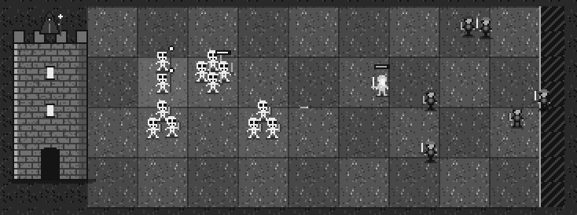

</div>

---

## Indice

- [Il gioco](#il-gioco)
- [Caratteristiche](#caratteristiche)
- [Screenshot](#screenshot)
- [Come si gioca](#come-si-gioca)
  - [Il ciclo di una run](#il-ciclo-di-una-run)
  - [Il castello: il menu principale](#il-castello-il-menu-principale)
  - [I livelli e i biomi](#i-livelli-e-i-biomi)
  - [Preparazione: squadra e necromante](#preparazione-squadra-e-necromante)
  - [La battaglia](#la-battaglia)
  - [Schieramento](#schieramento)
  - [Le unità scheletro](#le-unità-scheletro)
  - [Specializzazioni](#specializzazioni)
  - [Gli eroi nemici](#gli-eroi-nemici)
  - [I campioni degli eroi](#i-campioni-degli-eroi)
  - [I necromanti giocabili](#i-necromanti-giocabili)
  - [La torre](#la-torre)
  - [Salire di livello](#salire-di-livello)
  - [Le magie](#le-magie)
  - [Pergamene ed evocazione](#pergamene-ed-evocazione)
  - [Il negozio](#il-negozio)
  - [Le ricerche](#le-ricerche)
  - [Fine partita e modalità infinita](#fine-partita-e-modalità-infinita)
  - [Impostazioni, lingue e audio](#impostazioni-lingue-e-audio)
- [Comandi](#comandi)
- [Download e installazione](#download-e-installazione)
- [Aprire il progetto in Godot](#aprire-il-progetto-in-godot)
- [Personalizzazione dall'Inspector](#personalizzazione-dallinspector)
- [Strumenti per lo sviluppo](#strumenti-per-lo-sviluppo)
- [Struttura del progetto](#struttura-del-progetto)
- [Esportare le build](#esportare-le-build)
- [Test automatico](#test-automatico)
- [Roadmap](#roadmap)
- [Crediti](#crediti)

---

## Il gioco

Per secoli gli eroi del regno hanno dato la caccia ai necromanti. Ora tocca a te: chiuso nell'ultima torre rimasta, hai solo le ossa dei morti e la tua magia per sopravvivere.

**Gioco Scheletri** è un tower defense con elementi roguelike. Ondata dopo ondata gli eroi avanzano verso la tua torre: cavalieri nel cimitero, elfi nella palude, guerrieri del deserto tra le rovine della cattedrale, vichinghi sul passo di montagna. Prima di ogni run scegli il campo di battaglia, il necromante e quattro tipi di scheletri da portare. Poi li schieri, potenzi il necromante a ogni livello e scagli le sue magie. Quando la torre cade la partita finisce, ma ogni tentativo ti dà punti per le ricerche, pergamene per evocare nuove unità e monete d'osso per il negozio: alla run successiva torni più forte.

L'obiettivo è arrivare all'**ondata 100** di ogni livello. Poi si continua, in **modalità infinita**.

> Ispirazione: *Outhold*.

## Caratteristiche

- 🏰 **Un castello vivo come menu:** gli edifici sono i pulsanti, dietro le mura un'orda di eroi tenta l'assalto e nel cortile girano gli scheletri.
- 🗺️ **4 livelli in 4 biomi** (cimitero, palude nebbiosa, cattedrale in rovina, passo di montagna innevato), con corsie, canali, colonne crollate, crepacci e massi da aggirare.
- 💀 **20 tipi di scheletri** in 5 rarità, molti con un'abilità speciale: rianimare i caduti, nubi di peste, urli che stordiscono, totem, muri d'ossa, carcasse esplosive…
- 🌟 **Specializzazioni:** al rango 3 e al rango 5 ogni unità sceglie tra due rami (arciere di fuoco o tiro multiplo, piromante o mago delle tempeste…).
- 🧙 **3 necromanti giocabili**, ognuno con il suo potere, le sue 3 magie e il suo albero delle ricerche: Signore delle Ossa, Strega Pestilenziale, Lich del Ghiaccio.
- 👑 **40 campioni unici** degli eroi, uno ogni 10 ondate e diversi per ogni livello, ognuno con le sue mosse: dal *Capitano della Guardia* all'*Arcangelo*, dalla *Sentinella del Bosco* al *Grande Jinn*.
- 📜 **Pergamene ed evocazione:** unità a caso, più rare più difficili da trovare; i doppioni alzano il rango.
- 🛒 **Negozio** con le monete d'osso: pergamene, scrigni, nuovi necromanti.
- ♾️ **Modalità infinita** dopo l'ondata 100, con classifica per ogni livello.
- 🎬 **Fine partita cinematica** con la cronaca delle ondate e dei campioni battuti.
- 🔊 **Effetti sonori e musica**, con volumi separati per musica ed effetti.
- 🌍 **Italiano, inglese e spagnolo**, scelti al primo avvio.
- 📱 **Pensato anche per il telefono:** pulsanti grandi, tutorial guidato con la casella che lampeggia, tocchi che rispondono al primo colpo.
- 🎨 **Pixel art 16x16 in scala di grigi** con un solo colore d'accento per unità, prospettiva, luce da in alto a sinistra, ombre e nebbia.
- 🛠️ **Tutto regolabile dall'Inspector di Godot:** griglia, statistiche, livelli, campioni, necromanti, specializzazioni, suoni.

## Screenshot

| Il castello (menu) | Scelta del livello |
|---|---|
| 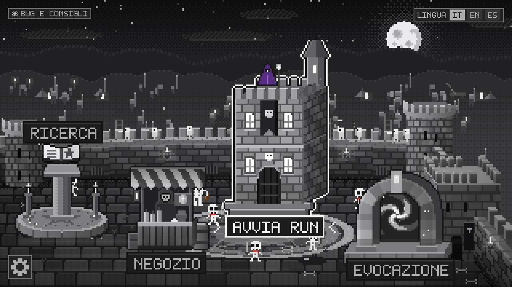 | 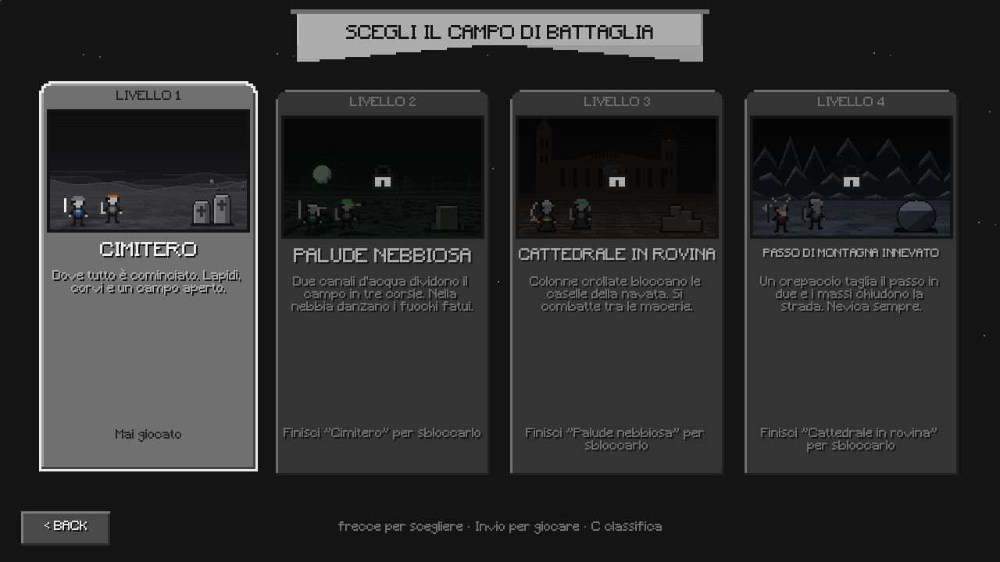 |
| **Preparazione: squadra e necromante** | **Specializzazioni** |
| 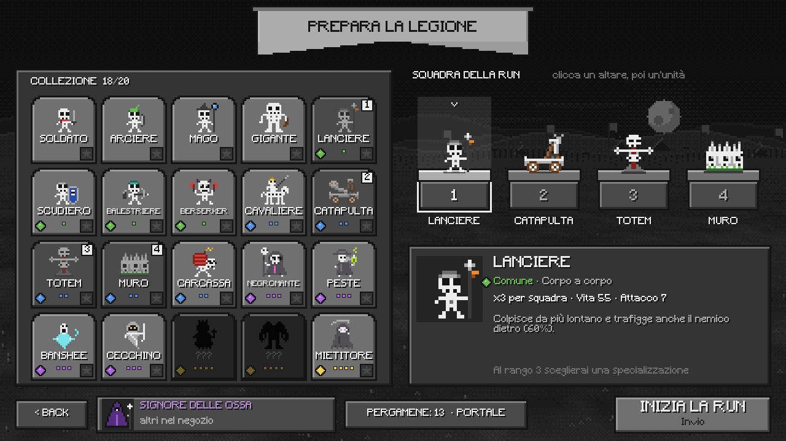 | 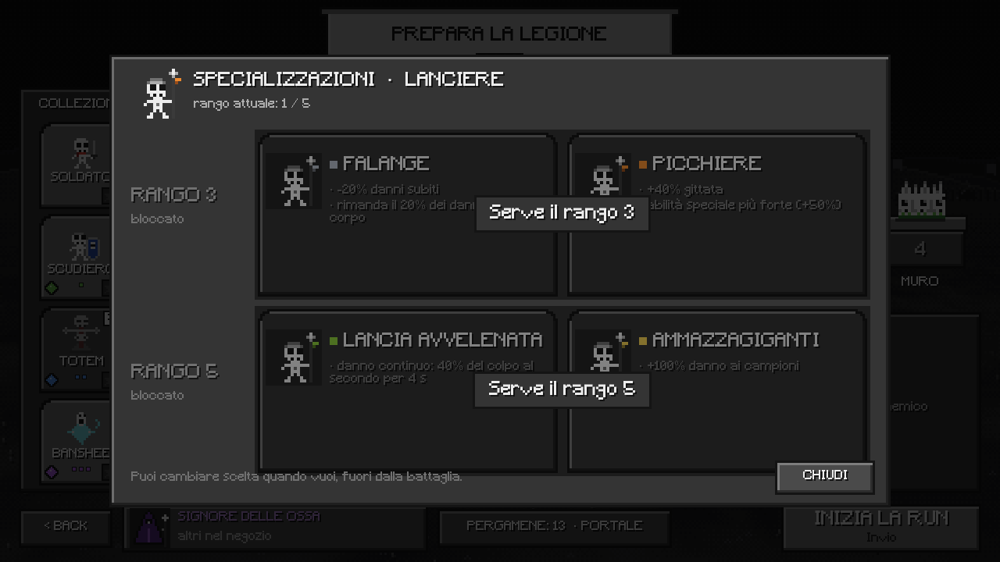 |
| **Schieramento (tutorial)** | **Battaglia nel cimitero** |
| 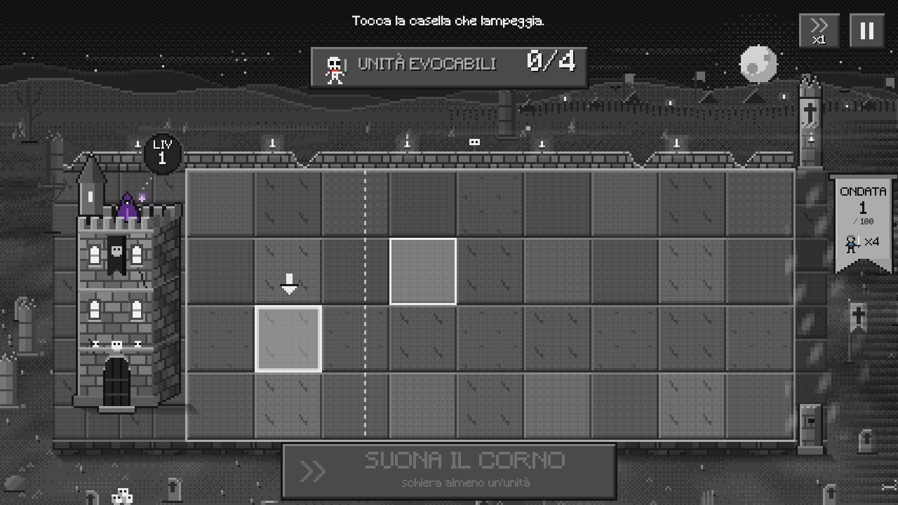 | 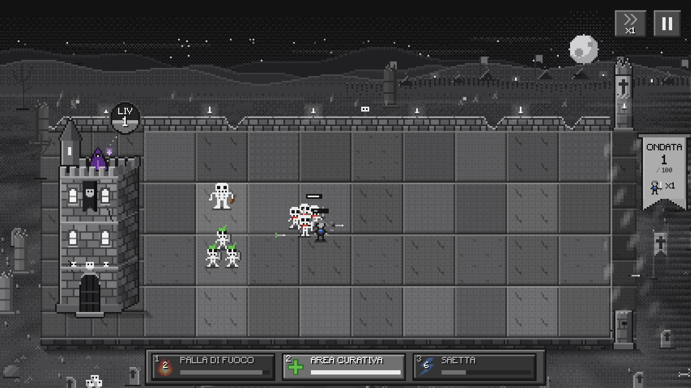 |
| **Palude nebbiosa: gli elfi** | **Cattedrale in rovina: i guerrieri del deserto** |
| 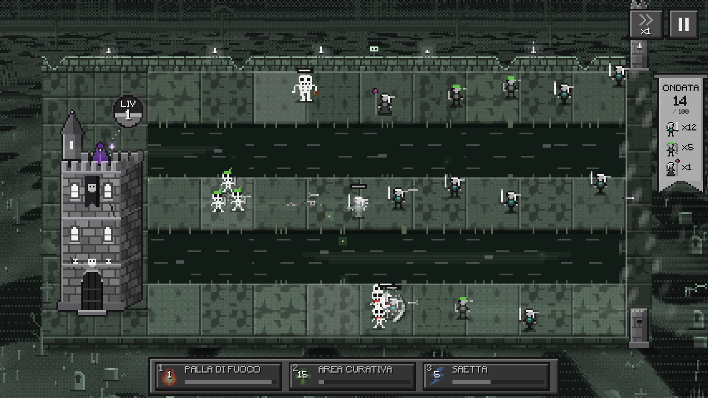 | 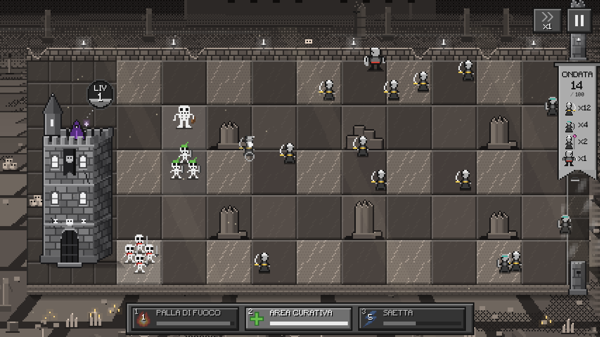 |
| **Passo di montagna: i vichinghi** | **Arriva un campione** |
| 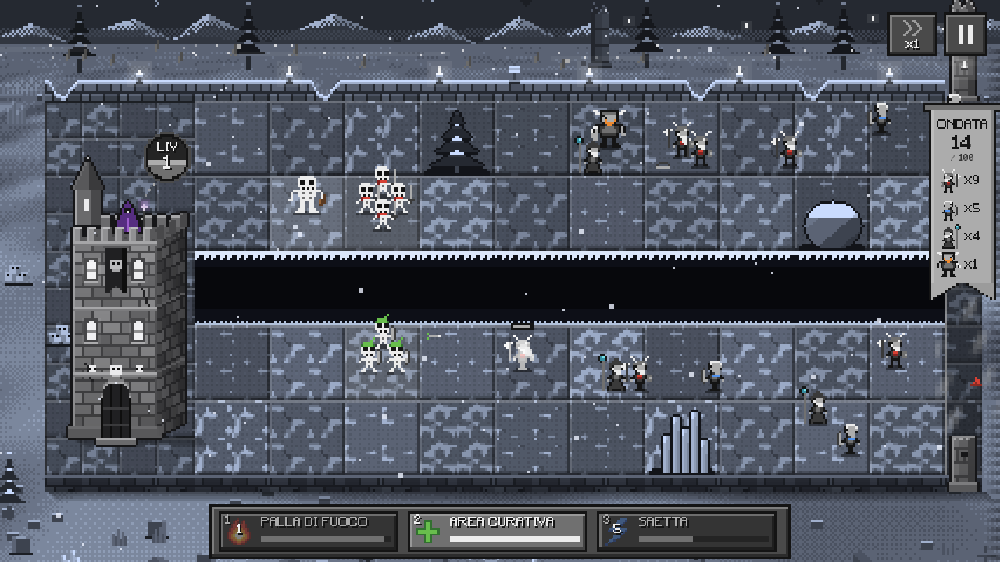 | 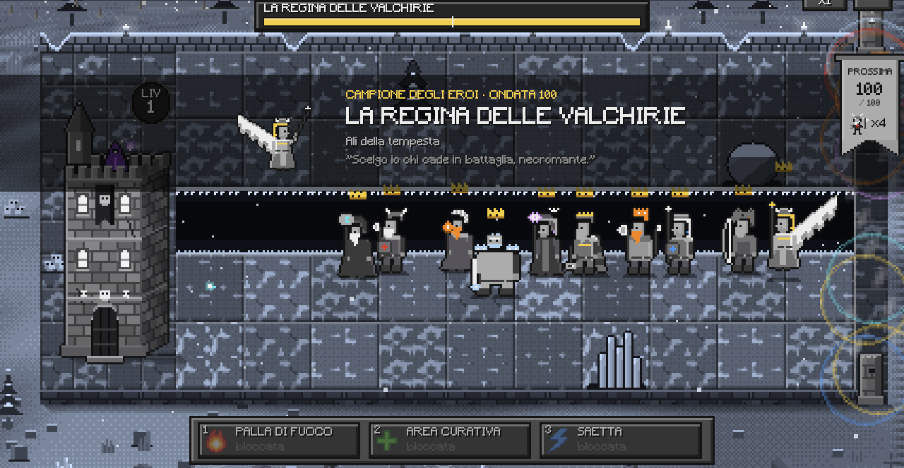 |
| **Evocazione: 10 pergamene** | **Il negozio** |
| 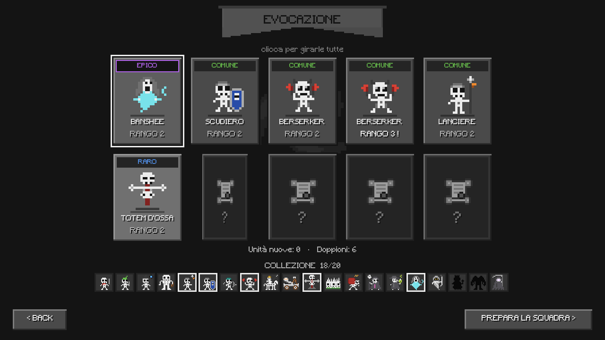 | 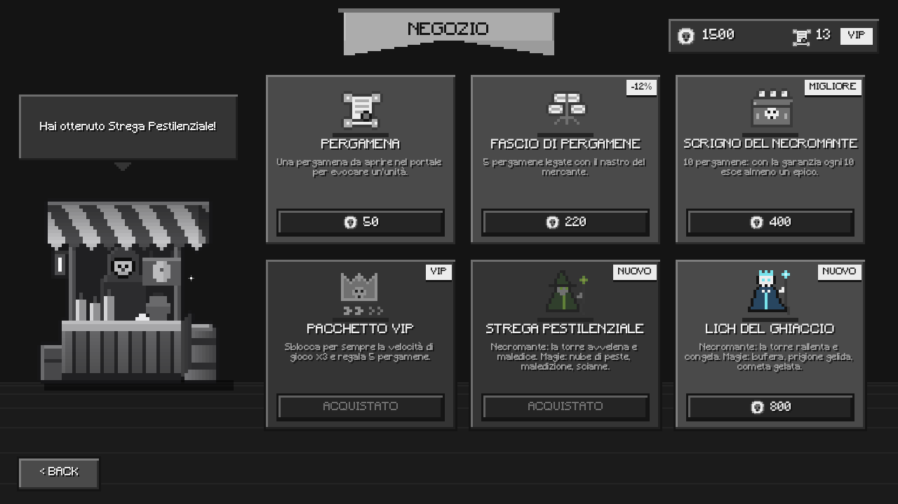 |
| **Ricerche (albero del Lich)** | **Fine partita** |
| 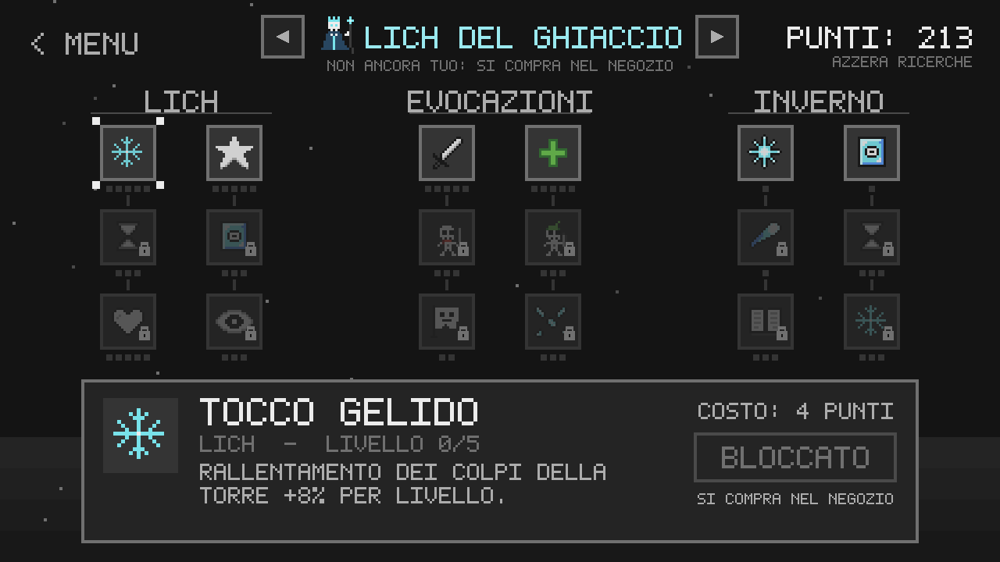 | 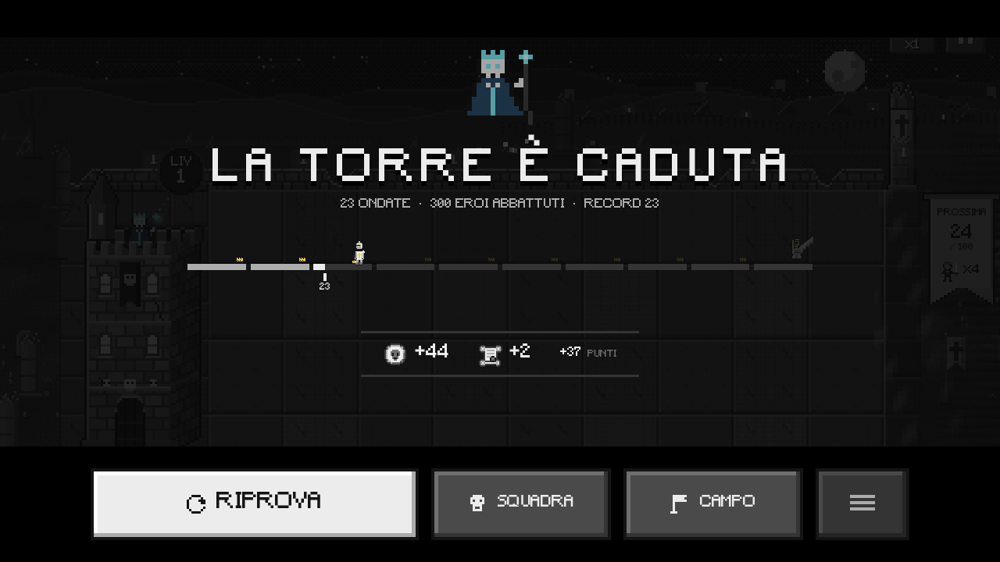 |

| Strega Pestilenziale e Lich del Ghiaccio in battaglia |
|---|
| 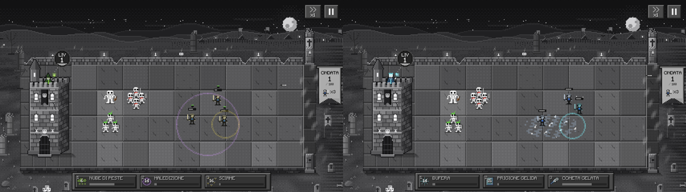 |

---

## Come si gioca

### Il ciclo di una run

```
 Castello ──► Livello ──► Preparazione ──► Battaglia ──► fine run ──► Castello
 (menu)       4 biomi     4 unità +        ondate 1→100   punti,         │
    │                     necromante       (poi infinita) pergamene,     │
    │                                                     monete d'osso  │
    ├──► Portale: apri le pergamene, trova nuove unità ◄─────────────────┤
    ├──► Negozio: pergamene e nuovi necromanti ◄──────────────────────────┤
    └──► Altare del libro: spendi i punti nelle ricerche ◄────────────────┘
```

- **Vittoria:** sopravvivi fino all'**ondata 100**. Il livello è finito: si sblocca il successivo e la sua modalità infinita.
- **Sconfitta:** la vita della torre arriva a zero. La torre non si cura mai da sola.
- A fine partita guadagni:
  - **punti ricerca:** uno per ondata superata, uno ogni 50 nemici uccisi, 50 di bonus se vinci;
  - **monete d'osso:** 2 per ondata superata, 300 di bonus se vinci;
  - **pergamene:** una ogni 10 ondate superate, salvata subito.

### Il castello: il menu principale

Il menu è il cortile del castello del necromante. Gli edifici sono i pulsanti e si illuminano al passaggio del mouse (o al tocco):

| Edificio | Cosa fa |
|---|---|
| 🏰 **Alloggio del necromante** · *AVVIA RUN* | Scelta del livello, poi preparazione della squadra |
| 📖 **Altare con il libro** · *RICERCA* | Gli alberi delle ricerche |
| 🌀 **Portale** · *EVOCAZIONE* | Apre le pergamene |
| 🛒 **Bancarella** · *NEGOZIO* | Pergamene, scrigni e necromanti con le monete d'osso |

Intorno agli edifici ci sono:

- **In alto a sinistra:** **Bug e consigli**, per mandare una segnalazione allo sviluppatore (con la tua app email o direttamente con un modulo Formspree).
- **In alto a destra:** la **lingua** (IT, EN, ES).
- **In basso a sinistra:** l'ingranaggio delle **Impostazioni**.

Dietro le mura un'orda di eroi tenta l'assalto con le scale, gli arcieri scheletro rispondono dai camminamenti e una catapulta lancia massi.

### I livelli e i biomi

Dopo *AVVIA RUN* scegli il campo di battaglia. Ogni livello si sblocca finendo quello prima.

| Livello | Il campo | Gli eroi |
|---|---|---|
| ⚰️ **Cimitero** | Campo aperto tra lapidi e corvi | Cavalieri del regno |
| 🌫️ **Palude nebbiosa** | Due canali dividono il campo in tre corsie; fuochi fatui nella nebbia | Elfi |
| ⛪ **Cattedrale in rovina** | Colonne crollate bloccano le caselle della navata | Guerrieri del deserto |
| 🏔️ **Passo di montagna innevato** | Un crepaccio taglia il passo, massi e abeti chiudono la strada; nevica sempre | Vichinghi |

Gli eroi **aggirano gli ostacoli** restando nella loro corsia; solo chi vola li sorvola. Ogni livello ha i suoi **10 campioni** (vedi [I campioni degli eroi](#i-campioni-degli-eroi)). Finito un livello, sulla sua carta compare la **modalità infinita** con la classifica.

### Preparazione: squadra e necromante

Prima di ogni run scegli le **4 unità** che potrai evocare per tutta la partita:

1. **Clicca un altare**, oppure premi i tasti `1`–`4`.
2. **Clicca un'unità della collezione** per metterla su quell'altare. Se è già in squadra, le due unità si scambiano di posto.
3. Con il **tasto destro** svuoti un altare.
4. **INIZIA LA RUN**, oppure `Invio`.

Ogni carta della collezione mostra:

- **la gemma colorata della rarità:** 🟢 comune, 🔵 raro, 🟣 epico, 🟡 leggendario;
- **il rango** (R2, R3…);
- **la stella delle specializzazioni**, per aprire la scelta dei rami.

Le unità ancora da trovare sono sagome scure, con la gemma spenta.

In basso c'è il **necromante della run**. Al primo tocco il riquadro a destra mostra il suo potere e le sue magie; al secondo tocco passi al prossimo necromante che possiedi.

### La battaglia

Il campo è una corsia vista di tre quarti:

```
                    muretto in rovina, torce, teschi
            ┌─────────────────────────────┐
            │  💀 UNITÀ EVOCABILI   1/4    │  ← solo durante lo schieramento
            └─────────────────────────────┘
 ┌──────┐ ┌───┬───┬───┬───┬───┬───┬───┬───┬───┐ ║ ┌─────┐
 │TORRE │ │   │   │   │   │   │   │   │   │   │ ║ │ONDATA│
 │  ◉   │ ├───┼───┼───┼───┼───┼───┼───┼───┼───┤ ║ │  5   │
 │ LIV  │ │   │  griglia di schieramento  │   │ ║ │ 🗡x4 │
 │      │ ├───┼───┼───┼───┼───┼───┼───┼───┼───┤ ║ │ 🏹x1 │
 │  ⌂   │ │   │   │   │   │   │   │   │   │   │ ║ └──▽──┘
 └──────┘ └───┴───┴───┴───┴───┴───┴───┴───┴───┘ portale
          [ »» SUONA IL CORNO · inizia l'ondata 1 ]   ← schieramento
          [ magia 1 ][ magia 2 ][ magia 3 ]           ← battaglia
   ◄──────────────── gli eroi avanzano ─────────────
```

- **A sinistra la torre** con il necromante in cima. Sopra c'è la **sfera d'anima** con il livello, che si riempie con l'esperienza.
- **Al centro la griglia di schieramento**, lastre di pietra in rilievo.
- **A destra il portale degli eroi**, nella nebbia: i nemici compaiono in un punto qualsiasi e avanzano verso la torre.
- **Lo stendardo** accanto al portale mostra l'ondata e i nemici rimasti, oppure quelli in arrivo.
- **In basso le tre magie** del necromante, con tasto rapido e ricarica.
- **In alto a destra** ci sono **velocità** (x1, x2, x3 con il pacchetto VIP) e **pausa**.

### Schieramento

1. Clicca una casella della griglia **a portata della torre**: attorno spuntano **quattro lapidi**, una per ogni unità della tua squadra. Si schiera solo dentro la linea tratteggiata (la gittata del necromante); le caselle più lontane sono scure.
2. Passa sopra una lapide per vedere le statistiche e, per le unità a distanza, la **gittata** disegnata sul campo.
3. Clicca la lapide (o premi `1`–`4`): gli scheletri **escono dal portone della torre** e marciano fino alla casella.
4. La targa in alto mostra quante **unità evocabili** hai usato (es. *1/4*). Di base sono 3; il Signore delle Ossa ne aggiunge una e la ricerca *Legione* altre. Tasto destro su una squadra per rimuoverla.
5. **Potenziare una squadra:** clicca una squadra già schierata ed evoca sopra un'unità dello stesso tipo. La squadra sale di livello (fino al 3): +40% vita e +30% danni per livello, torna a piena vita e chi era caduto esce subito dalla torre. Costa un'evocazione come una squadra nuova, e funziona anche con le evocazioni del level-up. I livelli si vedono dalle tacche sopra le teste.

   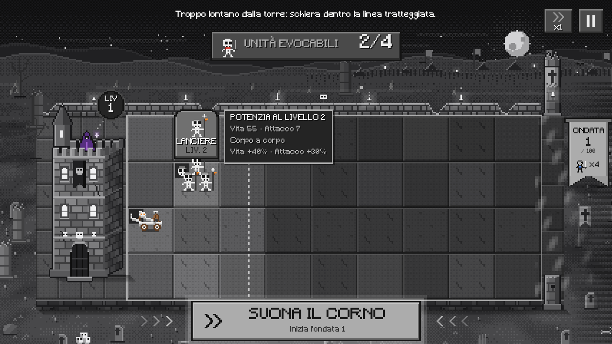

6. Premi **SUONA IL CORNO** per far partire le ondate. Se non hai schierato tutte le unità compare un avviso per qualche secondo: premendo di nuovo il corno si parte lo stesso.

**Al primo avvio** il necromante guida il giocatore:

- una casella lampeggia, con una freccia sopra, e finché non la tocchi le altre non rispondono;
- dopo la prima unità schierata, il necromante spiega il resto;
- alla seconda squadra spiega il potenziamento e fa lampeggiare le squadre che si possono potenziare.

Durante la partita arrivano altre squadre con le scelte "Evoca" del level-up. **A fine ondata il necromante rianima i caduti:** ogni squadra torna al completo e a piena vita.

### Le unità scheletro

Hai subito le quattro unità di **base**; le altre 16 si trovano aprendo le [pergamene](#pergamene-ed-evocazione). Valori di partenza, tutti modificabili dall'Inspector della scena di preparazione:

<details open>
<summary><b>Base</b>: le hai da subito</summary>

| Unità | Squadra | Vita | Attacco | Ruolo | Note |
|---|:---:|:---:|:---:|---|---|
| ⚔️ **Soldato scheletro** | 4 | 60 | 6 | Corpo a corpo | Fanteria: tanti, tengono la linea |
| 🏹 **Arciere scheletro** | 3 | 30 | 6 | A distanza | Gittata ≈ 2,8 caselle |
| 🔮 **Scheletro mago** | 2 | 25 | 14 | Magia | Sfere che esplodono ad area |
| 🦴 **Scheletro gigante** | 1 | 260 | 14 | Corpo a corpo | Un muro di ossa |

</details>

<details>
<summary>🟢 <b>Comuni</b> · ◆</summary>

| Unità | Squadra | Vita | Attacco | Abilità |
|---|:---:|:---:|:---:|---|
| **Lanciere** | 3 | 55 | 7 | Colpisce da più lontano e **trafigge** anche il nemico dietro (60%) |
| **Scudiero** | 2 | 150 | 3 | **Provoca** i nemici vicini e subisce il 30% di danni in meno |
| **Balestriere** | 2 | 35 | 14 | Dardi pesanti: un **secondo dardo** colpisce il nemico dietro |
| **Berserker** | 2 | 70 | 8 | **Furia:** più è ferito, più colpisce forte e veloce (fino al doppio) |

</details>

<details>
<summary>🔵 <b>Rari</b> · ◆◆</summary>

| Unità | Squadra | Vita | Attacco | Abilità |
|---|:---:|:---:|:---:|---|
| **Cavaliere scheletro** | 1 | 150 | 16 | **Carica:** dopo una corsa il colpo fa danno doppio |
| **Catapulta d'ossa** | 1 | 60 | 24 | Lancia teschi lontanissimo con danno ad area, ma non colpisce chi è troppo vicino |
| **Totem d'ossa** | 1 | 90 | — | **Aura:** gli scheletri vicini fanno +25% danni e attaccano più veloce |
| **Muro d'ossa** | 1 | 420 | — | Barricata: i nemici vicini devono abbatterla per passare |
| **Carcassa esplosiva** | 2 | 30 | 45 | Corre contro i nemici ed **esplode**; rinasce a fine ondata |

</details>

<details>
<summary>🟣 <b>Epici</b> · ◆◆◆</summary>

| Unità | Squadra | Vita | Attacco | Abilità |
|---|:---:|:---:|:---:|---|
| **Negromante minore** | 1 | 40 | 6 | **Rianima** come scheletri i nemici che muoiono vicino a lui (14 s, max 3) |
| **Stregone della peste** | 1 | 45 | 4 | Lascia **nubi di peste** che avvelenano e rallentano |
| **Banshee** | 1 | 50 | 6 | Un **urlo** che ferisce e stordisce tutti i nemici vicini |
| **Cecchino spettrale** | 1 | 30 | 34 | Gittata enorme: mira sempre il nemico con **più vita** |

</details>

<details>
<summary>🟡 <b>Leggendari</b> · ◆◆◆◆</summary>

| Unità | Squadra | Vita | Attacco | Abilità |
|---|:---:|:---:|:---:|---|
| **Lich** | 1 | 80 | 18 | Magie ad area che **maledicono**: i colpiti subiscono +30% danni da tutti |
| **Golem di ossa** | 1 | 520 | 22 | **Schianto:** ogni colpo ferisce anche chi è attorno |
| **Mietitore** | 1 | 110 | 20 | La **falce** colpisce tutti i vicini e finisce all'istante chi ha meno del 20% di vita |

</details>

Comportamento in battaglia:

- **Il corpo a corpo intercetta** i nemici che passano nelle file vicine, poi torna alla sua casella. Quando uno scheletro viene colpito, va verso chi lo sta attaccando e lo insegue finché non lo uccide.
- **Le unità a distanza** restano ferme e colpiscono chi entra nella loro gittata.
- **Catapulta, totem e muro** non si spostano mai.

### Specializzazioni

Al **rango 3** e al **rango 5** ogni unità sceglie tra **due rami**, che cambiano il suo modo di combattere (il rango sale con i doppioni delle pergamene). Si sceglie in preparazione, toccando la stella sulla carta, e si può cambiare quando vuoi, fuori dalla battaglia.

<details>
<summary><b>Tutti i rami</b> (clicca per aprire)</summary>

| Unità | Rango 3 (scegli uno) | Rango 5 (scegli uno) |
|---|---|---|
| **Soldato scheletro** | Legionario · Spadaccino | Veterano · Lama insanguinata |
| **Arciere scheletro** | Arciere di fuoco · Tiro multiplo | Arciere del gelo · Occhio di falco |
| **Scheletro mago** | Piromante · Mago delle tempeste | Criomante · Arcimago |
| **Scheletro gigante** | Sfondatore · Gigante corazzato | Titano · Gigante spinato |
| **Lanciere** | Falange · Picchiere | Lancia avvelenata · Ammazzagiganti |
| **Scudiero** | Scudo di spine · Bastione | Guardiano sacro · Scudo stordente |
| **Balestriere** | Dardi esplosivi · Ricarica rapida | Dardi perforanti · Dardi gelati |
| **Berserker** | Sete di sangue · Furia cieca | Doppie asce · Instancabile |
| **Cavaliere scheletro** | Lancia da torneo · Cavaliere nero | Travolgente · Paladino d'ossa |
| **Catapulta d'ossa** | Teschi infuocati · Catapulta pesante | Bombardamento · Teschi stordenti |
| **Totem d'ossa** | Totem di guerra · Totem della vita | Grande totem · Totem del gelo |
| **Muro d'ossa** | Muro spinato · Ossa antiche | Muro vivente · Muro gelido |
| **Carcassa esplosiva** | Carcassa incendiaria · Carcasse gemelle | Grande botto · Carcassa infetta |
| **Negromante minore** | Signore dei morti · Patto oscuro | Maledettore · Congrega |
| **Stregone della peste** | Nube densa · Morbo lento | Contagio · Nubi gemelle |
| **Banshee** | Urlo agghiacciante · Lamento lontano | Urlo straziante · Urlo gelido |
| **Cecchino spettrale** | Colpo mortale · Dardo spettrale | Cacciatore di campioni · Raffica |
| **Lich** | Lich del gelo · Lich della tempesta | Maledizione eterna · Filatterio |
| **Golem di ossa** | Golem di pietra · Golem tellurico | Golem di lava · Golem sismico |
| **Mietitore** | Mietitore d'anime · Falce insanguinata | Danza della morte · Falce maledetta |

</details>

I rami si modificano dall'Inspector: un file per unità in `specializzazioni/`.

### Gli eroi nemici

Gli eroi hanno quattro classi, **soldati**, **arcieri**, **maghi** e **giganti**, con un aspetto diverso in ogni bioma: cavalieri nel cimitero, elfi nella palude, guerrieri del deserto nella cattedrale, vichinghi in montagna. Le ondate crescono poco a poco: più eroi, più vita e più danni a ogni ondata. Arcieri, maghi e giganti entrano piano piano nelle ondate invece di comparire tutti insieme.

| Ondata | Cosa cambia |
|---|---|
| 1–2 | Solo soldati |
| 3+ | Arrivano gli arcieri (fino al 30% dell'ondata) |
| 7+ | Arrivano i maghi (fino al 15%) |
| 11+ | Arrivano i giganti (fino all'8%) |
| …7, …8, …9 | **Rampa verso il campione:** le 3 ondate prima di ogni campione sono sempre più numerose (+15%, +30%, +45%) |
| …1 | **Respiro:** l'ondata dopo un campione ha un quarto di eroi in meno |
| 5, 15, 25… | ⚔️ **Ondata speciale** a tema, a giro: *Assalto* (tanti soldati), *Pioggia di frecce*, *Circolo dei maghi*, *Carica dei giganti* |
| 5, 8, 13… | 🪽 Arrivano gli **eroi volanti** (ondate scelte dall'Inspector) |
| ogni 10 | 👑 Arriva un **campione**, con una scorta più piccola del solito |

I nemici attaccano gli scheletri che incontrano (prima chi li provoca, come scudieri e muri d'ossa); arrivati alla torre la colpiscono. Frecce e magie le fanno solo metà del danno, perché le mura reggono.

**Eroi volanti.** In alcune ondate (la prima è la 5) arrivano eroi che **volano dritti verso la torre**, sopra ostacoli, canali e scheletri. Spade e asce non li raggiungono: li colpiscono solo le **unità a distanza**, la **torre** e le **magie**. Al primo incontro il necromante ferma la partita per avvisarti.

| ⚰️ Cimitero | 🌫️ Palude | ⛪ Cattedrale | 🏔️ Montagna |
|---|---|---|---|
| Angeli guerrieri con l'aureola e la spada | Fate dalle ali lilla | Guerrieri su tappeti volanti | Corvi da guerra |

Le ondate con i volanti si scelgono dall'Inspector di ogni livello (gruppo *Eroi volanti*).

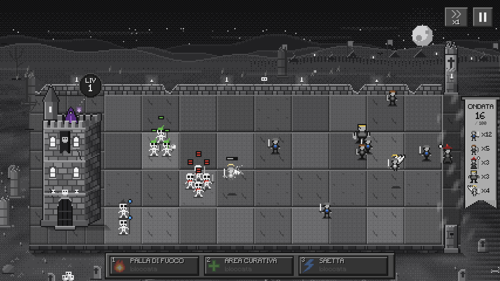

### I campioni degli eroi

Ogni 10 ondate arriva un **campione**:

- ha una presentazione tutta sua e una barra della vita in alto;
- usa le sue **mosse**, preannunciate da un segnale a terra: grida di battaglia, evocazioni, cure, schianti, piogge di frecce, meteore, colonne di luce, teletrasporti, resurrezioni…;
- dopo metà della vita entra nella **seconda fase**.

Ogni livello ha i suoi 10 campioni:

| Ondata | ⚰️ Cimitero | 🌫️ Palude | ⛪ Cattedrale | 🏔️ Montagna |
|:---:|---|---|---|---|
| 10 | Il Capitano della Guardia | La Sentinella del Bosco | Il Capo delle Guardie | Il Predone |
| 20 | L'Inquisitore | Il Druido dei Rovi | L'Alchimista | Lo Scaldo delle Braci |
| 30 | Il Gran Paladino | Il Custode della Quercia | Il Cavaliere delle Dune | Lo Jarl |
| 40 | La Regina Crociata | La Principessa della Luna | La Sultana | La Scudiera |
| 50 | Il Gran Cacciatore | Il Ranger del Crepuscolo | Il Falconiere | Il Cacciatore d'Orsi |
| 60 | L'Arcimago dell'Alba | L'Incantatrice delle Lucciole | L'Astronomo di Corte | Il Veggente delle Rune |
| 70 | Il Colosso di Bronzo | L'Ent Antico | Il Colosso d'Ottone | Il Gigante di Ghiaccio |
| 80 | La Santa Martire | La Sacerdotessa della Fonte | La Guaritrice dell'Oasi | La Volva |
| 90 | Il Gran Maestro dell'Ordine | Il Maestro delle Lame | Il Gran Visir | Il Re Berserker |
| 100 | 😇 **L'Arcangelo** | 🧚 **La Regina delle Fate** | 🧞 **Il Grande Jinn** | 🛡️ **La Regina delle Valchirie** |

I campioni dell'ondata 100 volano. In modalità infinita i campioni tornano, sempre più forti.

### I necromanti giocabili

Il necromante sulla torre si sceglie in preparazione. Ognuno ha il suo **potere**, le sue **3 magie** e il suo **albero delle ricerche**; i punti ricerca sono in comune.

| | 🟣 Signore delle Ossa | 🟢 Strega Pestilenziale | 🔵 Lich del Ghiaccio |
|---|---|---|---|
| **Come si ottiene** | Dall'inizio | Negozio, 500 monete d'osso | Negozio, 800 monete d'osso |
| **Potere** | +1 squadra da schierare; il 10% dei nemici uccisi si rialza come scheletro per 20 s (max 6 insieme) | I colpi della torre avvelenano e maledicono: i maledetti subiscono +40% danni | I colpi della torre rallentano del 30% e nell'8% dei casi congelano (metà del tempo su boss e campioni) |
| **Magie** | Palla di fuoco, Area curativa, Saetta | Nube di peste, Maledizione, Sciame | Bufera, Prigione gelida, Cometa gelata |


### La torre

Il necromante sta in cima alla torre e **spara da solo** al nemico più vicino. Con il mouse sopra la torre vedi la sua gittata e la targa con la vita (es. *TORRE 60/100*).

La vita si legge anche **dalla torre stessa**:

| Vita | Aspetto |
|---|---|
| sopra il 75% | Intatta |
| sotto il 75% | Prime crepe |
| sotto il 50% | Altre crepe, macerie alla base, un merlo crollato, fumo |
| sotto il 25% | Finestre in fiamme, stendardo strappato, fumo denso |

| Torre | Necromante (Signore delle Ossa) |
|---|---|
| 100 punti vita | 15 danni a colpo (Strega ×0,8, Lich ×0,9) |
| Non si cura mai | 1,25 colpi al secondo |
| Danno dimezzato da frecce e magie | Gittata ≈ 2,7 caselle dalla torre |

### Salire di livello

Uccidere eroi dà esperienza al necromante. A ogni livello il campo si scurisce e dal terreno emergono **tre lapidi** con altrettante scelte a caso:

| Scelta | Effetto |
|---|---|
| ⭐ Furia oscura | Attacco del necromante +25% |
| ⏳ Mano rapida | Velocità d'attacco del necromante +20% |
| ❤️ Mura d'ossa | Vita della torre +25 (massima *e* attuale: l'unico modo di recuperarne) |
| 🗡️ Lame affilate | Attacco delle unità +20% |
| » Ossa leggere | Velocità d'attacco delle unità +15% |
| ➕ Ossa robuste | Vita delle unità +20% |
| 👁️ Nebbia gelida · Peste · Terrore | Velocità, vita o attacco dei nemici −10% |
| 💀 Evocazione | Una nuova squadra della tua squadra, da piazzare dove vuoi |

Si sceglie con il mouse o con i tasti `1` `2` `3`.

### Le magie

Ogni necromante ha tre magie, da sbloccare nel suo albero delle ricerche. Clicca la magia nella fila in basso (o premi `1` `2` `3`), poi clicca sul campo per lanciarla; tasto destro annulla. La potenza cresce con l'attacco del necromante. Ogni magia ha la sua animazione e il suo suono.

| Necromante | Magia | Effetto | Ricarica |
|---|---|---|:---:|
| Signore delle Ossa | 🔥 **Palla di fuoco** | Danni alti in un'area media | 12 s |
| | ➕ **Area curativa** | Cura gli scheletri in un'area ampia (mai la torre) | 15 s |
| | ⚡ **Saetta** | Danni altissimi in un'area piccola | 8 s |
| Strega Pestilenziale | ☁️ **Nube di peste** | Nube per 5 s che avvelena, rallenta e maledice | 12 s |
| | 👁️ **Maledizione** | I nemici nell'area subiscono +50% danni per 8 s | 14 s |
| | 🪰 **Sciame** | Insetti velenosi su 10 nemici vicini | 16 s |
| Lich del Ghiaccio | ❄️ **Bufera** | Tempesta di neve per 5 s: rallenta del 50% e ferisce | 14 s |
| | 🧊 **Prigione gelida** | Congela i nemici in una piccola area per 2,5 s | 15 s |
| | ☄️ **Cometa gelata** | Cade dal cielo: danni altissimi e gelo dove tocca terra | 10 s |

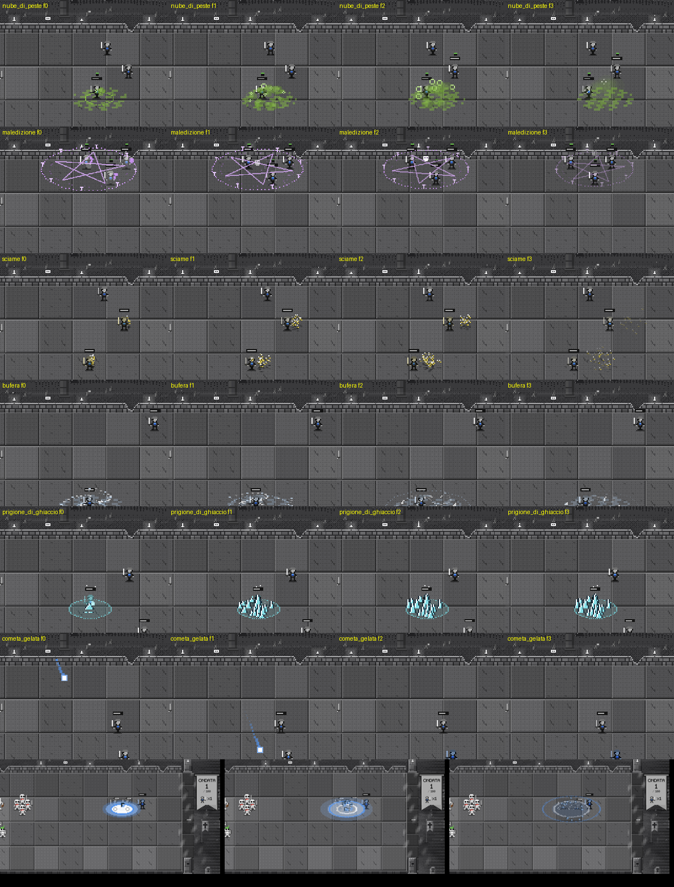

### Pergamene ed evocazione

Nel **portale** del castello apri le pergamene, una alla volta oppure **10 insieme**. Il vortice si carica, un lampo, ed ecco l'unità; la rarità è scritta nel suo colore.

- **Come si guadagnano:**
  - una pergamena ogni 10 ondate superate;
  - 3 in regalo alla prima partenza;
  - poi nel negozio.
- **Estrazione:** prima la rarità, poi un'unità a caso di quella rarità, **anche se l'hai già**:

  | Rarità | Probabilità | Unità | Ognuna |
  |---|:---:|:---:|:---:|
  | 🟢 Comune (con le 4 di base) | 50% | 8 | 6,25% |
  | 🔵 Raro | 30% | 5 | 6% |
  | 🟣 Epico | 15% | 4 | 3,75% |
  | 🟡 Leggendario | 5% | 3 | 1,67% |

- **Garanzia:** ogni 10 pergamene un'unità **epica o leggendaria** è assicurata.
- **Doppioni:** alzano il **rango** dell'unità, +10% vita e danno per rango fino al rango 5. Ai ranghi 3 e 5 si sblocca una [specializzazione](#specializzazioni).
- **Rango massimo:** un doppione diventa **monete d'osso** (10 comune, 25 raro, 60 epico, 150 leggendario).

### Il negozio

Alla bancarella del mercante si spendono le **monete d'osso**:

| Oggetto | Prezzo | Cosa dà |
|---|---|---|
| Pergamena | 50 | 1 pergamena |
| Fascio di pergamene | 220 | 5 pergamene |
| Scrigno del necromante | 400 | 10 pergamene |
| Strega Pestilenziale | 500 | Il necromante |
| Lich del Ghiaccio | 800 | Il necromante |
| Pacchetto VIP | 4,99 € | Velocità di gioco x3 per sempre e 5 pergamene *(pagamenti veri non ancora attivi: nelle build di prova l'acquisto è simulato)* |

Gli oggetti si aggiungono e si modificano dall'Inspector della scena `negozio.tscn`.

### Le ricerche

L'**altare con il libro** apre gli alberi delle ricerche: la progressione permanente tra una run e l'altra.

- **Un albero per necromante:** in alto ci sono il nome e le frecce ◀ ▶ per passare da un albero all'altro.
- **I punti sono in comune.** Gli alberi dei necromanti non ancora comprati si possono guardare ma non sbloccare.
- **Come si compra:** clicca un nodo e poi **SBLOCCA** o **POTENZIA**.
- **Azzera ricerche** restituisce i punti dell'albero che stai guardando.
- **I costi crescono a ogni livello**: completare un albero richiede molte partite.
- **Ascesa:** quando un albero è tutto al massimo si sblocca la sua ricerca **senza fine** (+2% danni e vita di torre e scheletri per livello, ogni livello costa 20 punti in più). Lì finiscono i punti che avanzano.

<details>
<summary><b>Signore delle Ossa</b>: albero completo</summary>

**Ramo Necromante**

| Ricerca | Effetto | Livelli | Costi | Richiede |
|---|---|:---:|---|---|
| Mura rinforzate | Vita della torre +20 per livello. | 5 | 4 · 8 · 16 · 26 · 42 | — |
| Furia oscura | Danno del necromante +10% per livello. | 5 | 5 · 11 · 22 · 35 · 57 | — |
| Occhio della notte | Gittata del necromante +20% per livello: si schiera anche più lontano dalla torre. | 6 | 6 · 14 · 27 · 41 · 57 · 66 | Mura rinforzate |
| Rito rapido | Velocità d'attacco del necromante +8% per livello. | 3 | 8 · 17 · 32 | Furia oscura |
| Saggezza proibita | Esperienza guadagnata +10% per livello: sali di livello prima. | 3 | 6 · 14 · 27 | Rito rapido |
| Raccolto d'ossa | Probabilità che un nemico ucciso si rialzi come scheletro +5% per livello. | 3 | 8 · 17 · 32 | Occhio della notte |

**Ramo Evocazioni**

| Ricerca | Effetto | Livelli | Costi | Richiede |
|---|---|:---:|---|---|
| Lame d'osso | Danno delle unità scheletro +10% per livello. | 5 | 5 · 11 · 22 · 35 · 57 | — |
| Ossa robuste | Vita delle unità scheletro +10% per livello. | 5 | 5 · 11 · 22 · 35 · 57 | — |
| Disciplina d'osso | Vita delle unità corpo a corpo +12% per livello. | 3 | 6 · 14 · 27 | Lame d'osso |
| Mira spettrale | Danno delle unità a distanza +12% per livello. | 3 | 8 · 17 · 32 | Disciplina d'osso |
| Arti occulte | Danno delle unità magiche +12% per livello. | 3 | 8 · 17 · 32 | Ossa robuste |
| Legione | Squadre schierabili a inizio partita +1 per livello. | 2 | 25 · 56 | Arti occulte |

**Ramo Arcano**

| Ricerca | Effetto | Livelli | Costi | Richiede |
|---|---|:---:|---|---|
| Palla di fuoco | Sblocca l'abilità Palla di fuoco: danni alti in un'area media. | 1 | 8 | — |
| Area curativa | Sblocca l'abilità Area curativa: cura gli scheletri in un'area ampia. | 1 | 8 | — |
| Saetta | Sblocca l'abilità Saetta: danni altissimi in un'area piccola. | 1 | 14 | Palla di fuoco |
| Potere arcano | Potenza delle abilità +15% per livello. | 3 | 10 · 22 · 43 | Saetta |
| Concentrazione | Tempo di ricarica delle abilità -10% per livello. | 3 | 10 · 22 · 43 | Area curativa |

**Ramo Ascesa**

| Ricerca | Effetto | Livelli | Costi | Richiede |
|---|---|:---:|---|---|
| Patto immortale | Danni e vita di torre e scheletri +2% per livello. | senza fine | 40 · 60 · 80 · … (+20 a livello) | tutto il resto dell'albero al massimo |

</details>

<details>
<summary><b>Strega Pestilenziale</b>: albero completo</summary>

**Ramo Strega**

| Ricerca | Effetto | Livelli | Costi | Richiede |
|---|---|:---:|---|---|
| Veleno potente | Veleno dei colpi della torre +20% per livello. | 5 | 4 · 8 · 16 · 26 · 42 | — |
| Ira della strega | Danno della torre +10% per livello. | 5 | 5 · 11 · 22 · 35 · 57 | — |
| Tossine lente | Il veleno della torre dura 1 secondo in più per livello. | 3 | 6 · 14 · 27 | Veleno potente |
| Malocchio | I colpi della torre maledicono 1 secondo in più per livello. | 3 | 6 · 14 · 27 | Ira della strega |
| Mura di rovi | Vita della torre +20 per livello. | 5 | 4 · 8 · 16 · 26 · 42 | Tossine lente |
| Rito del calderone | Velocità d'attacco della torre +8% per livello. | 3 | 8 · 17 · 32 | Malocchio |

**Ramo Evocazioni**

| Ricerca | Effetto | Livelli | Costi | Richiede |
|---|---|:---:|---|---|
| Lame avvelenate | I colpi degli scheletri avvelenano: 10% del danno al secondo per livello. | 5 | 5 · 11 · 22 · 35 · 57 | — |
| Ossa marce | Vita delle unità scheletro +10% per livello. | 5 | 5 · 11 · 22 · 35 · 57 | — |
| Contagio | Quando un nemico avvelenato muore, 20% per livello di contagiare chi gli sta vicino. | 3 | 6 · 14 · 27 | Lame avvelenate |
| Arti della congrega | Danno delle unità magiche +12% per livello. | 3 | 8 · 17 · 32 | Ossa marce |
| Esercito appestato | Squadre schierabili a inizio partita +1 per livello. | 2 | 25 · 56 | Contagio |
| Frecce intinte | Danno delle unità a distanza +12% per livello. | 3 | 8 · 17 · 32 | Arti della congrega |

**Ramo Malefici**

| Ricerca | Effetto | Livelli | Costi | Richiede |
|---|---|:---:|---|---|
| Nube di peste | Sblocca la magia Nube di peste: una nube che avvelena, rallenta e maledice. | 1 | 8 | — |
| Maledizione | Sblocca la magia Maledizione: i nemici nell'area subiscono il 50% di danni in più. | 1 | 8 | — |
| Sciame | Sblocca la magia Sciame: insetti velenosi su tanti nemici vicini. | 1 | 14 | Nube di peste |
| Potere del sabba | Potenza delle magie +15% per livello. | 3 | 10 · 22 · 43 | Sciame |
| Luna nera | Tempo di ricarica delle magie -10% per livello. | 3 | 10 · 22 · 43 | Maledizione |
| Anatema | I maledetti subiscono il 10% di danni in più per livello. | 3 | 10 · 22 · 43 | Luna nera |

**Ramo Ascesa**

| Ricerca | Effetto | Livelli | Costi | Richiede |
|---|---|:---:|---|---|
| Pestilenza senza fine | Danni e vita di torre e scheletri +2% per livello. | senza fine | 40 · 60 · 80 · … (+20 a livello) | tutto il resto dell'albero al massimo |

</details>

<details>
<summary><b>Lich del Ghiaccio</b>: albero completo</summary>

**Ramo Lich**

| Ricerca | Effetto | Livelli | Costi | Richiede |
|---|---|:---:|---|---|
| Tocco gelido | Rallentamento dei colpi della torre +8% per livello. | 5 | 4 · 8 · 16 · 26 · 42 | — |
| Furia del lich | Danno della torre +10% per livello. | 5 | 5 · 11 · 22 · 35 · 57 | — |
| Inverno lungo | Il rallentamento della torre dura mezzo secondo in più per livello. | 3 | 6 · 14 · 27 | Tocco gelido |
| Morsa di ghiaccio | Probabilità di congelare a ogni colpo della torre +4% per livello. | 3 | 6 · 14 · 27 | Furia del lich |
| Mura di ghiaccio | Vita della torre +20 per livello. | 5 | 4 · 8 · 16 · 26 · 42 | Inverno lungo |
| Cuore gelido | Il congelamento dura 0,3 secondi in più per livello. | 3 | 8 · 17 · 32 | Morsa di ghiaccio |

**Ramo Evocazioni**

| Ricerca | Effetto | Livelli | Costi | Richiede |
|---|---|:---:|---|---|
| Lame di brina | I colpi degli scheletri rallentano i nemici dell'8% per livello. | 5 | 5 · 11 · 22 · 35 · 57 | — |
| Ossa di ghiaccio | Vita delle unità scheletro +10% per livello. | 5 | 5 · 11 · 22 · 35 · 57 | — |
| Guardia d'inverno | Vita delle unità corpo a corpo +12% per livello. | 3 | 6 · 14 · 27 | Lame di brina |
| Frecce di ghiaccio | Danno delle unità a distanza +12% per livello. | 3 | 8 · 17 · 32 | Ossa di ghiaccio |
| Legione gelata | Squadre schierabili a inizio partita +1 per livello. | 2 | 25 · 56 | Guardia d'inverno |
| Schegge | I nemici congelati subiscono il 20% di danni in più per livello. | 3 | 8 · 17 · 32 | Frecce di ghiaccio |

**Ramo Inverno**

| Ricerca | Effetto | Livelli | Costi | Richiede |
|---|---|:---:|---|---|
| Bufera | Sblocca la magia Bufera: una tempesta di neve che rallenta e ferisce. | 1 | 8 | — |
| Prigione gelida | Sblocca la magia Prigione gelida: congela i nemici in una piccola area. | 1 | 8 | — |
| Cometa gelata | Sblocca la magia Cometa gelata: danni altissimi e gelo dove cade. | 1 | 14 | Bufera |
| Potere del gelo | Potenza delle magie +15% per livello. | 3 | 10 · 22 · 43 | Cometa gelata |
| Notte polare | Tempo di ricarica delle magie -10% per livello. | 3 | 10 · 22 · 43 | Prigione gelida |
| Inverno eterno | Gli effetti delle magie (gelo, bufera) durano il 20% in più per livello. | 3 | 10 · 22 · 43 | Notte polare |

**Ramo Ascesa**

| Ricerca | Effetto | Livelli | Costi | Richiede |
|---|---|:---:|---|---|
| Era glaciale | Danni e vita di torre e scheletri +2% per livello. | senza fine | 40 · 60 · 80 · … (+20 a livello) | tutto il resto dell'albero al massimo |

</details>

### Fine partita e modalità infinita

Quando la torre cade, o quando vinci, parte il **finale cinematico**:

- bande nere e il titolo;
- la **cronaca delle ondate**, con i campioni sconfitti;
- il bottino che si conta da solo: monete, pergamene e punti;
- quattro pulsanti grandi: **Riprova**, **Squadra**, **Campo** e **Menu**.

Se vinci puoi **continuare in modalità infinita** dalla stessa partita.

**Modalità infinita:** finito un livello, sulla sua carta compare la modalità infinita.

- Le ondate continuano oltre la 100, sempre più forti, e i campioni tornano.
- Ogni livello ha la sua **classifica** delle 10 corse migliori.

### Impostazioni, lingue e audio

- **Lingua:** al primo avvio scegli tra **italiano, inglese e spagnolo**. Si cambia quando vuoi dal menu, in alto a destra.
- **Impostazioni** (ingranaggio in basso a sinistra nel menu):
  - tre slider: **volume generale**, **musica**, **effetti**;
  - una casella per i **codici**.

  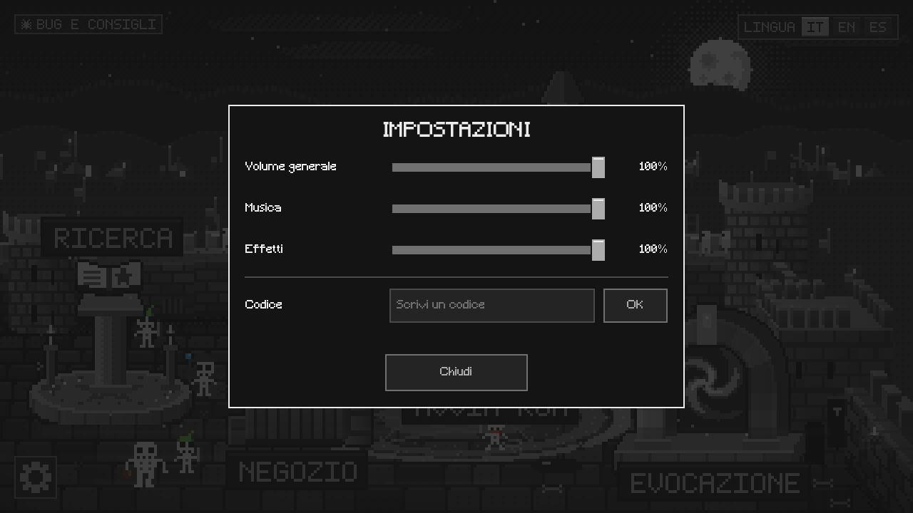
- **Audio:** effetti sonori retrò per attacchi, magie, morti, ondate, evocazioni e dialoghi. Musica ed effetti hanno bus separati («Musica», «Effetti»).
- **Musica:** 8 brani chiptune in loop, composti per il gioco:

  | Brano | Dove suona | Carattere |
  |---|---|---|
  | `ricerca.ogg` | Ricerche | Lento e misterioso, campane ed eco |
  | `evocazione.ogg` | Portale delle pergamene | Arpeggi mistici che salgono |
  | `schieramento.ogg` | Preparazione e schieramento in battaglia, fino al corno | Marcia con rullante |
  | `negozio.ogg` | Negozio | Saltellante, basso "um-pa" |
  | `cimitero.ogg` | Battaglia nel Cimitero | Cupa e incalzante |
  | `palude.ogg` | Battaglia nella Palude | Ondeggiante, flauto |
  | `cattedrale.ogg` | Battaglia nella Cattedrale | Organo e timpani |
  | `montagna.ogg` | Battaglia in Montagna | Epica, tamburi di guerra |

  Quando suoni il corno la musica dello schieramento sfuma in quella del livello.
- **Tutorial:** in ogni schermata il necromante spiega cosa fare la prima volta, con un dialogo a fumetto. Si può saltare con **SALTA**.

---

## Comandi

| Azione | Mouse / tastiera | Telefono |
|---|---|---|
| Menu: scegliere un edificio | Clic, oppure frecce/A-D + `Invio` | Tocco |
| Scegliere il livello | Clic sulla carta | Tocco |
| Preparazione: altare / unità | Clic, tasti `1`–`4`, tasto destro svuota | Tocco |
| Cambiare necromante | Clic sul riquadro in basso | Tocco (il primo mostra, il secondo cambia) |
| Specializzazioni | Clic sulla stella della carta, o tasto destro | Tocco sulla stella |
| Avviare la run | **INIZIA LA RUN** o `Invio` | Tocco |
| Evocare una squadra | Clic su una casella, poi su una lapide (o `1`–`4`) | Tocco |
| Rimuovere una squadra (schieramento) | Tasto destro | *non ancora disponibile* |
| Far partire le ondate | **SUONA IL CORNO** | Tocco |
| Vedere la gittata | Mouse su una lapide, una squadra o la torre | *non ancora disponibile* |
| Lanciare una magia | `1` `2` `3` o fila in basso, poi clic sul campo | Tocco |
| Annullare una magia | Tasto destro | *non ancora disponibile* |
| Scegliere il level-up | Clic su una lapide o `1` `2` `3` | Tocco |
| Velocità ×1 / ×2 / ×3 | `Spazio` o pietra in alto a destra | Tocco |
| Pausa (riprendi, ricomincia, menu) | `Esc` o pietra in alto a destra | Tocco |
| Aprire le pergamene | **APRI 1** / **APRI 10**, `Spazio` / `0` | Tocco |
| Ricerche: cambiare albero | Frecce ◀ ▶ in alto, `Q` / `E` | Tocco |

## Download e installazione

Scarica l'ultima versione dalla pagina [**Releases**](../../releases).

**🪟 Windows**
1. Scarica `GiocoScheletri_Windows.zip` ed estrailo.
2. Avvia `GiocoScheletri.exe`.
3. Se Windows mostra "PC protetto", clicca **Ulteriori informazioni → Esegui comunque**: l'eseguibile non è firmato.

**🤖 Android**
1. Scarica `GiocoScheletri.apk` sul telefono.
2. Aprilo e consenti l'installazione da origini sconosciute quando richiesto.
3. Funziona su dispositivi ARM a 32 e 64 bit.

**🍎 iPhone / iPad**

Per ora non c'è un file da installare direttamente: serve un **Mac con Xcode**. Vedi [Esportare le build](#esportare-le-build).

## Aprire il progetto in Godot

1. Installa **[Godot 4.7](https://godotengine.org/download)** (versione standard, non .NET).
2. Clona la repo:
   ```bash
   git clone https://github.com/<tuo-utente>/gioco-scheletri.git
   ```
3. In Godot scegli **Importa** e seleziona `project.godot`.
4. Premi **F5**: il gioco parte dal castello. Con **F6** su una scena di livello (es. `scenes/livelli/palude.tscn`) giochi subito quel livello.

---

## Personalizzazione dall'Inspector

Quasi tutto si regola senza toccare il codice.

**Scena `preparazione.tscn`, nodo `Preparazione`: statistiche delle unità**

Nella sezione **Statistiche delle unità** c'è un gruppo per ognuno dei 20 scheletri:

| Valore | Significato |
|---|---|
| Vita | Punti vita di ogni scheletro |
| Attacco | Danno per colpo |
| Velocità attacco | Attacchi al secondo |
| Gittata | Distanza di tiro (o portata del corpo a corpo), in pixel dell'arte: 32 = una casella |
| Velocità | Movimento; 0 = l'unità resta ferma |
| Quantità | Scheletri evocati da una squadra |
| Area | Raggio di esplosioni e colpi ad area |

La partita legge questi valori anche se avvii direttamente una scena di livello. Ricerche, rango, specializzazioni e level-up si applicano sopra.

**Scena `main.tscn`, nodo `Main`: la partita.** Le scene dei livelli in `scenes/livelli/` ereditano da questa e cambiano solo quello che serve.

| Gruppo / campo | Cosa controlla |
|---|---|
| Griglia di schieramento | **Colonne**, **File**, **Tile Per Casella**, file bloccate (canali) e ostacoli |
| Schieramento | **Entro gittata** (schierare solo vicino alla torre) e **Gittata schieramento** (0 = quella della torre) |
| Potenziamento delle squadre | Attivo, livello massimo, vita e danni in più per livello, dialogo che lo spiega |
| Eroi volanti | Attivi, **ondate** in cui arrivano, quanti, quanti in più ogni 10 ondate, ogni quante ondate in modalità infinita, dialogo |
| Bioma | Sfondo, terreno, ostacoli, meteo e **sprite degli eroi** del livello (`biomi/*.tres`) |
| Campioni degli eroi | L'elenco dei 10 campioni del livello (`campioni/…/elenco_campioni.tres`) |
| Ondate totali | Di solito 100 |
| Difficoltà delle ondate | Crescita di vita e danni degli eroi, quanti eroi, rampa prima dei campioni, respiro dopo, ondate speciali, forza e scorta dei campioni |
| Musica | **Musica Schieramento** (prima del corno); la musica del livello è lo stream del nodo `AudioStreamPlayer2D` |
| Interfaccia | **Tema Ui**, fine partita cinematica, grandezza del pulsante **SUONA IL CORNO**, durata dell'avviso |
| Torre del necromante | **Attaccata alla griglia**, **Fila**, **Gittata** |
| Colori degli effetti | Palla di fuoco, saetta, area curativa, nube di peste |
| Dialoghi | **Dialogo Tutorial** e **Dialogo Schieramento** |

**Le risorse da modificare con un doppio clic**

| Cartella | Cosa c'è |
|---|---|
| `livelli/elenco_livelli.tres` | Ordine, nomi e descrizioni dei livelli |
| `biomi/` | Un file per bioma: grafica, colori, eroi ed eroi volanti (*Sprite Volante*) |
| `campioni/` | Un file per campione: statistiche, sprite, frasi e mosse |
| `necromanti/` | Signore delle Ossa, Strega, Lich: nome, colore, prezzo, magie e poteri |
| `specializzazioni/` | I rami di ogni unità |
| `dialoghi/` | I dialoghi del tutorial |
| `assets/suoni/libreria_suoni.tres` | Ogni effetto sonoro: file, volume, variazione di tono |

**Scena `menu.tscn`, nodo `Menu`: il castello**

- **Animazioni:** numero di nemici dell'orda e di scheletri nel cortile.
- **Impostazioni:** grandezza dell'ingranaggio e codice sviluppatore.
- **Bug e consigli:** email e indirizzo Formspree per le segnalazioni, versione del gioco, tema.
- Gli edifici sono nodi `Sprite2D` in `Mondo/Cortile`, da spostare liberamente.

**Scena `negozio.tscn`:** la lista degli oggetti in vendita.

**Bilanciamento nel codice**

- `scripts/game_data.gd`:
  - unità, nemici e magie;
  - ondate e campioni;
  - probabilità e colori delle rarità;
  - rango, monete d'osso.
- `scripts/research_data.gd`: i tre alberi delle ricerche.

**Grafica**

| File | Contenuto |
|---|---|
| `assets/sprites.png` | Scheletri e umani di base, icone, necromante, corona |
| `assets/unita_scheletri.png` | Le 16 unità delle pergamene |
| `assets/biomi/` | Campi, ostacoli ed eroi di ogni bioma (elfi, guerrieri del deserto, vichinghi) |
| `assets/nemici/volanti/` | Gli eroi volanti dei 4 biomi (2 frame: ali su, ali giù) |
| `assets/campioni/` | Gli sprite dei 40 campioni |
| `assets/necromanti/` | Strega e Lich, icone delle loro magie e ricerche |
| `assets/campo/`, `assets/menu/`, `assets/negozio/` | Campo di battaglia, castello, bancarella |

Tutto in scala di grigi con un colore d'accento per unità, tile 16×16, luce da in alto a sinistra. Le sprite guardano a destra (gli eroi vengono specchiati) e hanno i piedi sull'ultima riga di pixel.

## Strumenti per lo sviluppo

Nelle build di prova (editor ed *Export With Debug*) c'è il **dev tool**:

| Comando | Cosa fa |
|---|---|
| `Ctrl` + `Shift` + `D` | Apre il **pannello dev** |
| `Ctrl` + `Shift` + `M` | Fondi infiniti nel negozio |
| `Ctrl` + `Shift` + `T` | Rifà il primo avvio: scelta della lingua e dialoghi |

Il pannello dev ha cinque schede:

- **Unità:** collezione e ranghi;
- **Ricerche:** livello di ogni nodo dei tre alberi;
- **Risorse:** pergamene, monete, punti, VIP, necromanti, tutorial;
- **Livelli:** sblocca o completa i livelli e gioca subito quello che vuoi;
- **Partita:** solo in battaglia; vinci l'ondata, salta a un'ondata, evoca un campione, torre invincibile, magie senza ricarica, velocità x5.

**Sul telefono:** scrivi il **codice sviluppatore** nelle Impostazioni (si imposta nell'Inspector del nodo `Menu`). In alto a destra compare il tasto **DEV**, che apre il pannello in ogni schermata, anche nelle build finali. Prima di pubblicare, svuota il campo del codice.

## Struttura del progetto

```
gioco-scheletri/
├── project.godot
├── tema.tres                    # tema dell'interfaccia (font pixel)
├── assets/                      # grafica, suoni, musica, font
├── biomi/                       # i 4 biomi (.tres)
├── campioni/                    # i 40 campioni: cimitero + palude/, cattedrale/, montagna/
├── dialoghi/                    # dialoghi del tutorial
├── lingue/testi.csv             # traduzioni (italiano, inglese, spagnolo)
├── livelli/elenco_livelli.tres  # i 4 livelli
├── necromanti/                  # Signore delle Ossa, Strega, Lich
├── specializzazioni/            # i rami di ogni unità
├── scenes/
│   ├── menu.tscn                # il castello (scena di avvio)
│   ├── selezione_livello.tscn   # scelta del livello e classifiche
│   ├── preparazione.tscn        # squadra, necromante, statistiche delle unità
│   ├── main.tscn                # la partita (livello Cimitero)
│   ├── livelli/                 # palude, cattedrale, montagna (ereditano da main)
│   ├── evocazione.tscn          # il portale delle pergamene
│   ├── negozio.tscn             # la bancarella
│   └── research.tscn            # alberi delle ricerche
├── scripts/
│   ├── main.gd                  # partita: campo, ondate, level-up, magie, interfaccia
│   ├── unit.gd                  # scheletri ed eroi: comportamento, abilità, stati
│   ├── campione.gd, campione_unita.gd, mossa_campione.gd, segnale.gd   # campioni e mosse
│   ├── necromante.gd, necromanti.gd        # necromanti giocabili
│   ├── specializzazioni.gd, rami_unita.gd, specializzazione.gd       # rami delle unità
│   ├── collezione.gd            # collezione, pergamene, rango, squadra
│   ├── research_data.gd         # i tre alberi delle ricerche
│   ├── portafoglio.gd           # monete d'osso, VIP, acquisti, dev tool
│   ├── livelli.gd               # progressi dei livelli e classifiche
│   ├── fine_partita.gd          # finale cinematico
│   ├── fx.gd, projectile.gd, resti.gd      # effetti, proiettili, resti
│   ├── suoni.gd, libreria_suoni.gd         # audio
│   ├── lingua.gd, scelta_lingua.gd         # lingue
│   ├── dialoghi.gd              # finestra dei dialoghi
│   ├── impostazioni.gd          # pannello impostazioni
│   ├── dev_tool.gd, pannello_dev.gd        # strumenti di sviluppo
│   └── …                        # schermate (menu, preparazione, negozio…) e interfaccia
└── docs/screenshots/            # immagini di questo README
```

I progressi vengono salvati in `user://`:

- `progressi.cfg`: punti, record, ricerche, collezione, pergamene, squadra, livelli, classifiche, monete, necromanti, dialoghi visti;
- `audio.cfg`: i volumi;
- `impostazioni.cfg`: lo sblocco del dev tool.

## Esportare le build

Il progetto usa il renderer **Compatibility**, quindi gira anche su PC poco potenti e sui telefoni. I preset *Windows Desktop*, *Android* e *iOS* sono in `export_presets.cfg`.

1. In Godot: **Editor → Gestisci modelli di esportazione** e scarica i template 4.7.
2. Nelle Impostazioni progetto lascia attivo **Rendering → Textures → VRAM Compression → Import ETC2 ASTC**: Android e iOS lo richiedono.
3. **Android:**
   - imposta in **Impostazioni editor → Export → Android** il percorso dell'Android SDK e un keystore;
   - per l'invio diretto dei feedback serve il permesso **Internet** nel preset.
4. **iOS:**
   - si può esportare da qualsiasi computer, ma si ottiene un **progetto Xcode**;
   - l'app (`.ipa`) si costruisce solo su un **Mac con Xcode**;
   - in Xcode, alla voce **Signing & Capabilities**, scegli il tuo team Apple al posto del segnaposto;
   - con un account gratuito l'app sul telefono dura 7 giorni.

> 🔑 Non pubblicare mai il keystore di rilascio nella repo: aggiungilo al `.gitignore`.

## Test automatico

Il gioco può giocare da solo per controllare il bilanciamento:

```bash
godot --headless --path . --fixed-fps 60 -- --autotest                        # unità di base, tutto sbloccato
godot --headless --path . --fixed-fps 60 -- --autotest --fresh                # come alla prima run
godot --headless --path . --fixed-fps 60 -- --autotest --squadra=lanciere,lich,totem,muro
godot --headless --path . --fixed-fps 60 -- --autotest --rango=5 --rami=ab    # rango e rami delle specializzazioni
godot --headless --path . --fixed-fps 60 -- --autotest --necromante=strega    # ossa, strega o lich
```

L'autotest stampa l'andamento ogni 5 ondate e il risultato finale, e non tocca la tua collezione né le tue pergamene. `--necromante=` funziona anche senza autotest, per provare un necromante in partita.

---

## Roadmap

Suggerimenti e contributi sono benvenuti: apri una *issue*, oppure usa **Bug e consigli** nel menu del gioco!

### ✅ Fatto finora
- [x] 🏰 Menu a forma di castello animato, con l'assedio dietro le mura.
- [x] 🧱 Campo di battaglia in prospettiva, con torre 3D e portale degli eroi.
- [x] 🪦 Interfaccia dentro il campo: lapidi, stendardo dell'ondata, sfera d'anima, torre che si danneggia.
- [x] 📜 Pergamene, evocazione e collezione di **20 scheletri** in 5 rarità, con doppioni e ranghi.
- [x] 🌟 **Specializzazioni** di tutte le unità ai ranghi 3 e 5.
- [x] 👑 **40 campioni unici**, 10 per livello, ognuno con le sue mosse.
- [x] 🗺️ **4 livelli in 4 biomi**, con eroi diversi, canali, colonne, crepacci e ostacoli da aggirare.
- [x] 🧙 **3 necromanti giocabili**, ognuno con il suo albero delle ricerche e le sue magie.
- [x] ♾️ **Modalità infinita** con classifica per ogni livello.
- [x] 🛒 **Negozio** con le monete d'osso.
- [x] 🎬 Fine partita cinematica con la cronaca delle ondate.
- [x] 🎵 Effetti sonori, musica e volumi separati.
- [x] 🌍 Italiano, inglese e spagnolo.
- [x] 📱 Tocchi che rispondono al primo colpo, pulsanti grandi, tutorial guidato dello schieramento.
- [x] 🛠️ Pannello dev, anche sul telefono.

### 🔜 Prossimi passi
- [ ] 📱 **Controlli touch completi:** tieni premuto per vedere la gittata o rimuovere una squadra, annulla le magie con un gesto.
- [ ] 🔢 **Numeri del danno** che saltano fuori dai bersagli, con i colpi critici più grandi.
- [ ] ⚖️ **Bilanciamento** di unità, specializzazioni, necromanti e campioni dopo le prime partite.
- [ ] ⚔️ **Nuovi eroi:**
  - **Chierico:** cura gli alleati.
  - **Paladino:** aura che indebolisce i non-morti.
  - **Cacciatore di streghe:** punta direttamente la torre.
  - **Ariete d'assedio:** lento ma devastante contro le mura.
- [ ] 🧩 **Sinergie e formazioni:** squadre adiacenti danno bonus.
- [ ] 🎲 **Reliquie roguelike** dopo ogni campione, con un effetto potente e un prezzo.
- [ ] 🌘 **Eventi delle ondate:**
  - *Luna di sangue:* scheletri più forti.
  - *Alba:* gli eroi brillano di luce sacra.
  - *Nebbia:* gittate ridotte per tutti.
  - *Eclissi:* i nemici arrivano da entrambi i lati.
- [ ] 🔥 **Trappole e terreno:** fosse di ossa, rovi maledetti.
- [ ] 🌗 **Ciclo giorno/notte** durante la run.
- [ ] 📅 **Sfida giornaliera**, **bestiario** e **obiettivi**.
- [ ] 💳 **Pagamenti veri** per il pacchetto VIP.
- [ ] 🛒 Pubblicazione su **itch.io**, **Google Play**, **App Store** e, perché no, **Steam**.

---

## Crediti

- **Game design e sviluppo:** *il tuo nome qui*
- **Motore:** [Godot Engine](https://godotengine.org) (licenza MIT)
- **Effetti sonori:** sintetizzati per il gioco
- **Font:** `Minecraft.ttf`, `The Inquisition.ttf` *(aggiungi autori e licenze)*
- **Musica:** 8 brani sintetizzati per il gioco (`assets/music/*.ogg`); menu e scelta del livello usano ancora `chiptune-grooving` *(aggiungi autore e licenza)*
- **Ispirazione:** *Outhold*

## Licenza

*Scegli una licenza e aggiungi il file `LICENSE`.* Per esempio MIT per il codice e CC BY-NC per la grafica.

<div align="center">

---

*Fatto con 💀 e Godot.*

</div>
